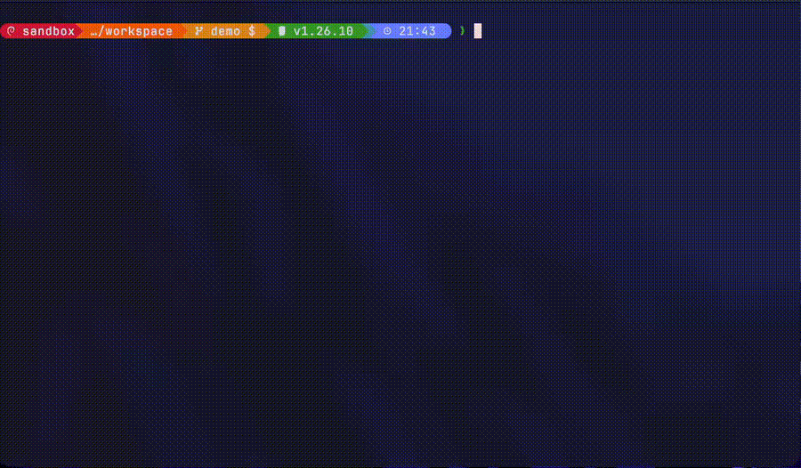

# pidshooter

[](https://github.com/eirikur-ari/pidshooter/actions/workflows/candidate.yaml?query=branch%3Amaster)
[](https://github.com/eirikur-ari/pidshooter/releases)
[](go.mod)
[](LICENSE)

A terminal game and CLI for hunting down and killing processes. Play it as a point-and-click shooter where the targets are real running processes, or query and kill matches directly.

In the game, running processes that match a name pattern show up as bouncing `[PID name]` labels on your terminal, and clicking one sends it `SIGKILL`.

<p align="center">
  
</p>

## Install

### Release binaries

Download the archive for your platform from the [releases page](https://github.com/eirikur-ari/pidshooter/releases/latest). Archives are published for Linux and macOS, on both amd64 and arm64, and are named `pidshooter_<version>_<os>_<arch>.tar.gz`. Each release includes a `checksums.txt` with the SHA-256 of every archive.

```
tar -xzf pidshooter_<version>_<os>_<arch>.tar.gz
./pidshooter --version
```

### Verify a download

Verify an archive before you extract it. Download `checksums.txt` from the same release into the same directory.

**Checksum.** This detects a corrupted or incomplete download. It prints `OK` when the archive matches:

```
sha256sum --ignore-missing -c checksums.txt
```

**Build provenance.** Each archive has a signed build provenance attestation, created by the release workflow with [GitHub's attest-build-provenance action](https://github.com/actions/attest-build-provenance). It proves the archive was built by this repository's release workflow on GitHub Actions, which a checksum alone can't prove, because `checksums.txt` is published next to the archives. Verify it with the [GitHub CLI](https://cli.github.com):

```
gh attestation verify pidshooter_<version>_<os>_<arch>.tar.gz --repo eirikur-ari/pidshooter
```

To also require that it came from the release workflow, add `--signer-workflow eirikur-ari/pidshooter/.github/workflows/release.yaml`.

### From source

```
go install github.com/eirikur-ari/pidshooter/cmd/pidshooter@latest
```

## Usage

```
pidshooter <command> [flags]
```

| Command | Description |
|---|---|
| `play` | Play the game: shoot the processes that match your patterns |
| `list` | _Not implemented yet_ |
| `kill` | _Not implemented yet_ |

Run `pidshooter --help` or `pidshooter <command> --help` for the full reference.

### Global flags

These work with every command, before or after the command name.

| Flag | Description |
|---|---|
| `--include-root` | Also target root-owned processes |
| `--i-am-root` | Allow running as root |

### `play`

```
pidshooter play <pattern> [pattern2] [pattern3...] [flags]
```

Every running process whose name contains one of the patterns (case-insensitive) becomes a target. Patterns must be at least 3 characters long.

```
pidshooter play firefox
pidshooter play chrome firefox node
pidshooter play firefox --confirm
pidshooter play node --speed=2.5 --time=60
```

| Flag | Description |
|---|---|
| `--confirm` | Ask for confirmation before each kill |
| `--speed=N` | Speed multiplier, `0.5` to `5.0` (default `2.0`) |
| `--time=N` | Time limit in seconds, `0` for no limit, max `300` (default `30`) |

In game, click a label to kill it, use `+` and `-` to change the speed, and press `q` or `Esc` to quit. Your best runs are kept in a local high score table.

## Configuration

The defaults of every flag except `--i-am-root` can be persisted in `$HOME/.config/pidshooter/config.yaml` (or `$XDG_CONFIG_HOME/pidshooter/config.yaml`, if set to an absolute path):

```yaml
game:
  confirm_mode: true
  speed: 3.0
  time_limit: 60
process:
  include_root: false
```

The `game` keys only affect `play`. A value is resolved in this order, and the last one wins: the built-in default, then the config file, then a flag on the command line. A persisted value that fails validation is dropped with a warning, and the rest of the file still applies.

## Safety

- By default only processes owned by you are targets. Root-owned processes need `--include-root`.
- pidshooter refuses to run as root, because every process on the machine would become a one-click kill target. `--i-am-root` overrides this, and it is deliberately never read from the config file.
- Before a kill, the process is re-verified so a recycled PID can't hit an unrelated process.
- The game itself and any process with PID 1 or lower are never targets.
- Windows is not supported.

## Development

You need Go (the version is pinned in `go.mod`) and `make`. Run `make help` to list every target.

If you use [asdf](https://asdf-vm.com), the [.tool-versions](.tool-versions) file selects the Go version in your terminal.

| Target | Description |
|---|---|
| `make build` | Compile the binary into `bin/` |
| `make run ARGS="play sleep"` | Build and run |
| `make test` | Unit and integration tests with the race detector |
| `make test-acceptance` | Build the binary, then run the acceptance tests against it |
| `make coverage` | Tests plus a function coverage report |
| `make vet` / `make lint` | Static checks and formatting/tidy checks |
| `make vuln-lint` | Check dependencies and the toolchain for known vulnerabilities |
| `make all` | The full local pipeline: vet, lint, build, tests, acceptance tests, packaging and checksums |

### Devcontainer

The repository ships a [devcontainer](.devcontainer) with the Go toolchain, Claude Code, and an outbound firewall (`init-firewall.sh`) that restricts network access from inside the container. Because the container is isolated from your machine, the game can kill processes there without touching your host.

You can use it from any devcontainer-aware editor (for example VS Code or IntelliJ), or from the terminal with the [devcontainer CLI](https://github.com/devcontainers/cli):

| Target | Description |
|---|---|
| `make dev-start` | Build (if needed) and start the devcontainer |
| `make dev-shell` | Open a shell in the running devcontainer (`zsh` by default, `DC_SHELL=bash` to change the shell) |
| `make dev-status` | Show the devcontainer status |
| `make dev-stop` | Stop the devcontainer |
| `make dev-rebuild` | Rebuild it from scratch, without the cache |
| `make dev-destroy` | Remove the devcontainer and its image |

The container needs the `NET_ADMIN` and `NET_RAW` capabilities for the firewall, which the configuration requests automatically. To use Claude Code inside it, set `CLAUDE_CODE_OAUTH_TOKEN` in your host environment before starting it. Go module and build caches live in named volumes, so they survive a rebuild.

### Architecture

The code follows a hexagonal layout: `internal/core`, `internal/application`, `internal/infrastructure`, `internal/entrypoint` and `internal/composition`. See [docs/hexagonal-arc.md](docs/hexagonal-arc.md) for the details.

## Releases

Pushes to a branch run the `Dev` workflow. Pull requests and `master` run `Release Candidate`, which verifies the build, runs the acceptance tests against the built binary, and runs the SonarQube analysis. A release is cut by manually dispatching the `Release` workflow with a plain `X.Y.Z` version. Its notes are taken from the matching section of [CHANGELOG.md](CHANGELOG.md).

## License

Apache License 2.0. See [LICENSE](LICENSE).
