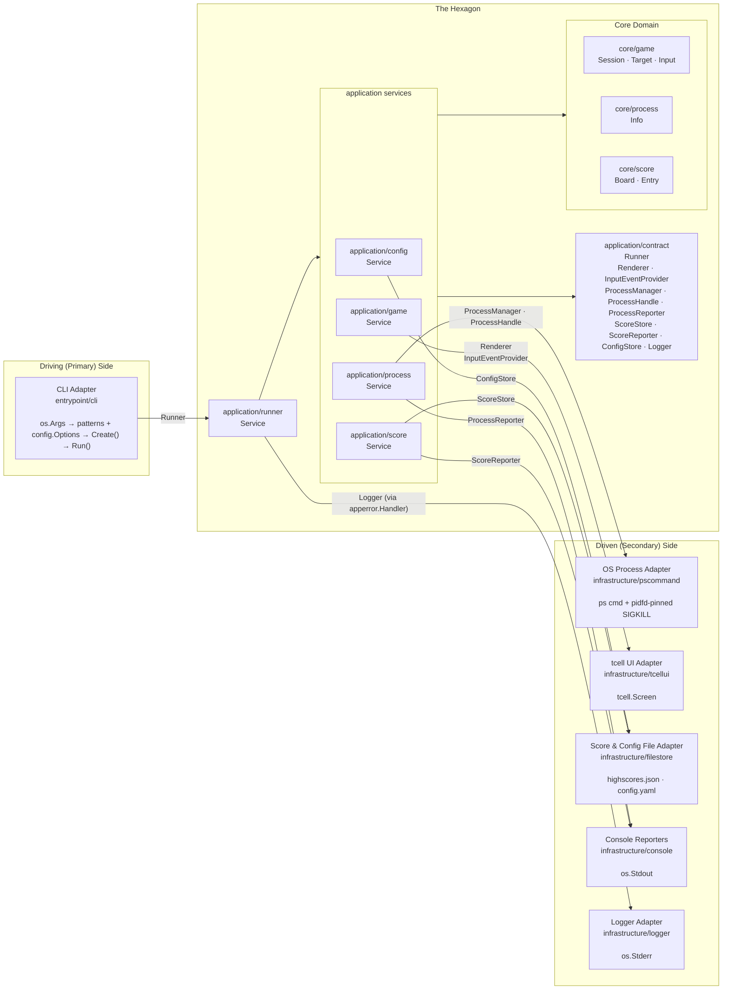
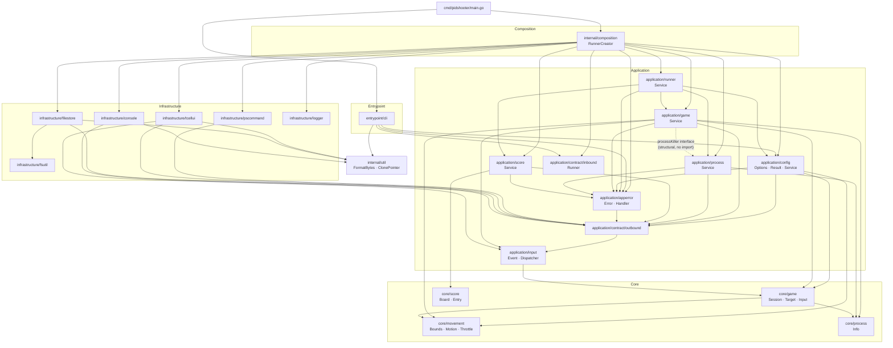

# Hexagonal Architecture — Design Record for pidshooter

*Originally a migration proposal (2026-06-26). Migration completed 2026-07-01. Further refactoring completed 2026-07-06: `domain` → `core`, `adapter` → `infrastructure`/`entrypoint`, `app` → `application`, port interfaces moved to `application/contract`. A second round of refactoring completed 2026-08-20: `Game` → `Session`, the inbound port renamed `GamePlay`/`Play()` → `Runner`/`Run()`, the single `GameService` split into three focused services (`application/game`, `application/process`, `application/score`) composed by a top-level `application.Runner`, and `outbound.Process` renamed `ProcessManager`. A third round completed 2026-09-22, covering a full pass over every open review finding (see `docs/leftovers.md`, since renamed `docs/improvement-finding.md`): the composition root moved out of `main.go` into its own `internal/composition` package, `outbound.ProcessManager`'s `Lister`/`Killer` split was superseded by a single PID-pinning `Process`/`ProcessHandle` pair, `outbound.ProcessReporter`/`ScoreReporter` ports replaced direct `fmt.Printf` calls, `cobra` was removed in favor of hand-rolled flag parsing, a structured `apperror` package now classifies every error by code and severity, and several domain-safety and naming fixes landed in `core/game`/`core/score`. A fourth round completed 2026-09-29: `application/config` split into `Request`/`Result` types merged across three tiers (hardcoded defaults < a new persisted `~/.config/pidshooter/config.yaml` < the caller's request), `infrastructure/filescore` was renamed again to `infrastructure/filestore` and gained the config-file store alongside the score-file store, a root-safety refusal guard (`core/process.ValidateRoot` + `--i-am-root`) was added, `application/runner.go` became its own `internal/application/runner` package, and `apperror.Handle` became an instance method on a constructed `*apperror.Handler` backed by a real `outbound.Logger` port. A fifth, small change on 2026-09-30: `outbound.Process` renamed back to `outbound.ProcessManager` (§7) — same single-interface shape from the third round, reusing August's name because "Process" alone had again become ambiguous against `core/process`/`application/process`. A sixth round, started in that same 2026-09-30 commit and continued through a file-by-file test-hardening pass completed 2026-10-13: the inbound port lost its request (`Runner.Run()`; patterns and config options are bound at construction via `RunnerCreator.Create(patterns, options)`), `config.Request` became constructor-injected `config.Options`, `outbound.ConfigStoreResult` became `outbound.Config` and `ModeYolo` became `ModeLucky`, every application service now speaks its own request/result types with `application/runner` reaching them only through consumer-side interfaces, `application/game` was split into a play session, in-flight kills, and kill-result types, `input.EventDispatcher` became `input.Event`, `infrastructure/osprocess` was renamed `infrastructure/pscommand`, the `apperror` codes were consolidated, and test doubles moved into their consuming packages, mostly as testify mocks. Sections 3–9 describe this current, live codebase. Sections 2, 10, and 11 document the original pre-refactor state and the reasoning behind the 2026-07 migration — kept as a design record. Section 13 documents the 2026-08 changes, section 14 the 2026-09 (September) changes, section 15 the 2026-09 (late September) changes, and section 16 the 2026-10 changes, each the same way — some of sections 14's and 15's detail has since been superseded again; where that's so, the later section says.*

---

## Contents

1. [What hexagonal architecture means here](#1-what-hexagonal-architecture-means-here)
2. [Previous architecture: what works and what leaks](#2-previous-architecture-what-works-and-what-leaks)
3. [The three layers](#3-the-three-layers)
4. [Conceptual diagram](#4-conceptual-diagram)
5. [Package structure](#5-package-structure)
6. [Component-by-component mapping](#6-component-by-component-mapping)
7. [Port interfaces (contracts)](#7-port-interfaces-contracts)
8. [Detailed package dependency graph](#8-detailed-package-dependency-graph)
9. [Composition root](#9-composition-root)
10. [What changed and why](#10-what-changed-and-why)
11. [Migration path](#11-migration-path)
12. [Trade-offs](#12-trade-offs)
13. [Further refactoring: service decomposition (2026-08)](#13-further-refactoring-service-decomposition-2026-08)
14. [Further refactoring: ports hardening & composition split (2026-09)](#14-further-refactoring-ports-hardening--composition-split-2026-09)
15. [Further refactoring: config resolution & root-safety hardening (2026-09)](#15-further-refactoring-config-resolution--root-safety-hardening-2026-09)
16. [Further refactoring: port cleanup & test hardening (2026-10)](#16-further-refactoring-port-cleanup--test-hardening-2026-10)

---

## 1. What hexagonal architecture means here

Hexagonal architecture (Ports & Adapters, Alistair Cockburn, 2005) separates software into three concentric zones:

| Zone | Responsibility | Rule |
|---|---|---|
| **Domain** | Business logic — what the application *is* | No imports from outer layers; no infrastructure |
| **Ports** | Contracts — what the domain *needs* or *exposes* | Interfaces only, owned by the application layer |
| **Adapters** | Infrastructure — how the world *connects* to the domain | Implements ports; imports libraries and OS APIs |

The "hexagon" is just the domain + its port interfaces. Everything outside is an adapter. There is no hexagonal shape; the name refers to the six notional faces Cockburn drew to show multiple interchangeable adapters around a single core.

Two kinds of adapters:

- **Driving (primary)** — they initiate action: the CLI parses `os.Args` and calls into the application.
- **Driven (secondary)** — they are called by the application service: OS process discovery, tcell rendering, JSON score storage.

---

## 2. Previous architecture: what works and what leaks

### What already followed the pattern

- `process.Finder` and `process.Info` were interfaces — `finder` was already an unexported implementation detail.
- `internal/testutil` existed for test doubles, meaning the seams were already being felt.
- `runner.go` separated the orchestration concern from `main.go`.
- `score`, `game`, and `process` were in distinct packages with clear responsibility labels.

### Where infrastructure leaked into the domain

| Location | Leak |
|---|---|
| `game/target.go: Kill()` | Called `os.FindProcess` + `syscall.SIGKILL` directly — the OS syscall was inside a domain entity |
| `game/loop.go: render()` | Called `tcell.Screen.SetContent` directly — rendering technology was baked into game logic |
| `game/loop.go: init()` | Created `tcell.NewScreen()` inside the game — screen lifecycle was the game's problem |
| `game/loop.go: run()` | Polled `g.screen.PollEvent()` inside the game loop — input source was hardwired |
| `score/score.go` | Called `os.ReadFile` / `os.WriteFile` directly — persistence technology was inside a domain type |

These were typical for a first implementation. Extracting each concern makes it independently testable and swappable without touching game logic.

---

## 3. The three layers

### Layer 1 — Core domain

Pure Go. No imports except the standard library and other core packages. Contains the game's invariants, entities, and value objects. Nothing in `core` imports `internal/util`, `application`, or `infrastructure` — confirmed zero outward edges.

- **`core/game`** — `Session`, a pure state machine (targets via an internal `roster`, `lifecycle` state, `timer`, `confirmation`, `throttle`); `Target` entity, holding `process.Info` and `movement.Motion` as ordinary **named** fields (not embedded — deliberately, so neither type's methods or fields are promoted onto `Target`; see §14 for why); `State` enum (`Alive`/`Killing`/`Fleeing`/`Dead`); `Input`, the intent-level gateway (`OnQuit`, `OnYes`, `OnClickAt`, …) the application layer's input events call into; and `ValidateTimeLimit`, used by both `application/config` and `application/game`.
- **`core/movement`** — `Vector` (in its own `vector.go`, with `Rounded()` to the nearest integer cell), `Motion` (`NewMotion(bounds, width int)`/`Move(bounds, speed, width int)` — `width` is the moving thing's horizontal extent, an `int` at every call site), `Bounds` (`NewBounds(WindowSize, ChromeSize)`, `Update(window)`), `Throttle` (plus the free `ValidateSpeed`), `speed` — pure physics/speed value objects, used by `core/game`.
- **`core/process`** — `Info` struct (`PID`, `Name`, `Rss`, `UID`), `Info.IsProtected()`/`IsKillableBy()`, `Find()`, and the `Validate*` family (`ValidateProcesses`, `ValidateName`, `ValidatePatterns`, `ValidateRoot`). `ValidateRoot(ownUID int, allowRoot bool) error` is new in the September (late) round — see §15.
- **`core/score`** — `Board`, `Entry`, ranking logic (`Entry.beats`, `Entry.isScore`). `NewBoard` seeds the board's unexported `highScore` from the best loaded entry, and `Add` keeps it at the top score from *before* the insert, so `IsNewHighScore(kills)` is true only when `kills` is strictly higher than the best score the board held before the session; `HighScore()` returns the current top entry's kills. There is no separate `Tracker` type here any more — per-session kill/failure/dud bookkeeping during a live game (`killTracker`) is an `application/game`-level concern now, not a domain type; `core/score` only knows about persisted, ranked `Entry` values.

The core domain contains **no port interfaces**. It exposes data types that the contracts in `application/contract` reference. This keeps import cycles impossible: core never imports application or infrastructure.

### Layer 2 — Application service

One layer above the core. Defines the port interfaces (contracts) and implements the use-case: resolve the run configuration, find processes, run a game, persist the score. Responsibility is split across four focused services (`config`, `process`, `game`, `score`), composed by one top-level `runner.Service`, plus two small supporting packages: `apperror`, shared by everything above `core`, and `input`, the user-input event types. Each service speaks its own request/result types (`config.Options`/`Result`, `process.FindRequest`/`FindResult`, `game.PlayRequest`/`PlayResult`, `score.LoadResult`/`RecordRequest`/`RecordResult`/`ReportRequest`/`BoardEntry`) rather than core or port types, so a caller never has to import the core packages or ports a service is built on (see §16). The one exception is `config.Result.Mode`, which is `outbound.Mode` directly (§7).

- **`application/config`** — `Options`/`Result`. `Options` (`GameOptions{ConfirmMode, Speed, TimeLimit *pointers}`, `ProcessOptions{IncludeRoot, AllowRoot *pointers}`) holds only what the caller explicitly provided — a nil field means the caller didn't set it — and is bound at construction (`NewService(store outbound.ConfigStore, options Options)`), not passed per call. `Service.Load() (Result, error)` resolves `Result` (`GameResult`, `ProcessResult` — the same fields, concrete values) by merging three tiers in order: hardcoded defaults < the persisted config file (read via the injected `outbound.ConfigStore`) < the options, with the options always winning. An invalid option fails `Load` outright (`CodeInvalidConfig`, `Fatal`) before the store is read; a missing config file silently means defaults; any other store failure (`CodeStoreFailed`) or an invalid stored field (`CodeInvalidConfig`, dropped and named) is a `Warning`, with a usable `Result` still returned. `Result` also carries a `Mode` (`outbound.Mode`: `ModeGame`/`ModeLucky`/`ModeList`) that resolves through the stored tier but isn't read anywhere yet — it anticipates planned, not-yet-built list/lucky CLI modes. `ProcessOptions.AllowRoot`/`ProcessResult.AllowRoot` are deliberately excluded from the config-file tier — see §15.
- **`application/apperror`** — `Code`/`Severity` enums, an `Error` type carrying both (with an unexported `logged` flag, making it safe to pass the same `*Error` through `Handle` more than once — logged only the first time), and `Handler` — constructed with an injected `outbound.Logger` (`NewHandler(logger outbound.Logger) *Handler`), not called as a bare package function. The codes are `CodeUnknown`, `CodeInvalidConfig`, `CodeProcessNotFound`, `CodeGameFailed`, `CodeKillFailed`, and `CodeStoreFailed`; `Code.In(err)` reports whether an error carries that code, looking through plain wrapping but never into the cause of another `*Error`, which is a separately classified problem. `Severity`'s zero value is `SeverityUnknown`. `Handler.Handle(err)` is the single place that decides whether an error is logged-and-swallowed (`Warning`/`Error` severity) or returned up to the caller (`Fatal`/`Unknown` severity); `Handler.HandleAll(errs)` does the same for a batch, handling every error and returning the first that must still fail. One `*Handler` instance is built at the composition root and threaded down through `runner.Service` and `cli.Program`, so `entrypoint/cli` never has to know *why* an error is fatal, only that `Handle` already decided.
- **`application/contract/inbound/runner.go`** — the `Runner` interface (`Run() error`) and nothing else; `inbound` imports no other package. Everything one run needs (search patterns, config options) is bound when the `Runner` is built (§9), not passed to `Run`.
- **`application/contract/outbound/*.go`** — `Renderer`, `InputEventProvider`, `ProcessManager`/`ProcessHandle`, `ProcessReporter`, `ScoreStore`, `ScoreReporter`, `ConfigStore`, `Logger` interfaces and their mirror data types (`FrameViewState`, `ProcessInfo`, `ScoreBoard`, `ScoreSummary`, `Config`, `GameConfig`/`ProcessConfig`, …). Full source in §7.
- **`application/input`** — the `Event` interface (`ClickEvent`, `QuitEvent`, `ConfirmEvent`, `SpeedEvent`) and `Dispatcher`. `Event`'s only method is the unexported `dispatch(*game.Input) *game.Target`, so the set of events is closed to this package and each event applies itself to `core/game.Input`; `Dispatcher.Dispatch(Event) *game.Target` invokes it and returns the target hit, if any. (Renamed from `application/event` — the package now holds the event *types* themselves, not just the dispatcher, so `event` stopped fitting. The interface itself was `EventDispatcher` until 2026-10 — see §16.)
- **`application/game`** — `Service`, owning the game loop: `Play(request PlayRequest) (PlayResult, error)`. `PlayRequest{ConfirmMode, Speed, TimeLimit, Processes []ProcessRequest, HighScore}` carries everything one session needs, including the targets as `application/game`'s own `ProcessRequest{PID, Name, Rss, UID}` (converted to `core/process.Info` inside) — not imported from `config` or `process` (see §15, §16). `Play` validates the speed/time limit (`CodeInvalidConfig`) and the process list (`CodeProcessNotFound`), then runs a `playSession` (`play_session.go`: renderer `Init`/`Cleanup`, an OS-signal watcher, the 20 FPS `frameLoop`, and `drainEventQueue`), classifying any failure as `CodeGameFailed`. Kills go through `inFlightKills` (`in_flight_kills.go`): each hit target's kill runs in its own goroutine via the unexported `processKiller` interface, finished kills queue on a buffered channel as `killResult` values (`kill_result.go`) that are applied to the `killTracker` once per frame, and once the session stops `awaitRemaining` waits up to a bounded grace period for any kill still in flight. `killTracker` is the live, per-session score/failure/dud bookkeeping; `killFailure`/`killDud` (each in its own file) convert themselves into `Warning`-severity `*apperror.Error`s (`CodeKillFailed`/`CodeProcessNotFound`), returned in `PlayResult.Errors []error` alongside `Duration`, `LowestSpeed`, `Kills`, `FreedMem`, and `Duds`. The pure `converter.go` mapping functions build `outbound.FrameViewState` each tick. Knows nothing about score persistence or config resolution.
- **`application/process`** — `Service`, owning process discovery and verified termination. It is built with the search patterns (`NewService(manager outbound.ProcessManager, reporter outbound.ProcessReporter, patterns []string)`), so `FindProcesses(request FindRequest) ([]FindResult, error)` takes only `FindRequest{IncludeRoot, AllowRoot bool}`. `FindProcesses` calls `core/process.ValidateRoot` first, before pattern validation or discovery, refusing outright if the caller is root and `request.AllowRoot` is false; it then reports the matched processes via the injected `outbound.ProcessReporter` and returns them as its own `FindResult{PID, Name, Rss, UID}`. `Kill(pid, name, protected) error` pins the target PID before re-verifying its name, closing the discovery-to-kill TOCTOU window. Every `Kill` failure is a `Warning`, classified `CodeProcessNotFound` if and only if the process is already gone or its PID now belongs to another process (a `NotFoundError` from `Pin`, `LookupName`, or `ProcessHandle.Kill`, or a name mismatch), and `CodeKillFailed` otherwise, including a protected target. `FindRequest` is structurally identical to `config.ProcessResult` but not imported from it (see §15, §16).
- **`application/score`** — `Service`, owning score board load/record/report through its own types (`BoardEntry`, `LoadResult`, `RecordRequest`, `RecordResult`, `ReportRequest`), reporting results via an injected `outbound.ScoreReporter` instead of printing directly. `LoadScoreBoard() (LoadResult, error)` returns the ranked entries and the high score to beat; any load failure is a `CodeStoreFailed` warning alongside an empty result. `RecordScore(RecordRequest) (RecordResult, error)` ranks the session against the entries the request carries (for the result it returns), then reloads the latest persisted board itself, adds the session to that, and saves it — so a score another run saved in the meantime isn't overwritten. A missing or corrupted latest board counts as empty; any other read failure skips the save. `ReportResults(ReportRequest)` hands the summary to the reporter.
- **`application/runner`** — `Service`, implementing `inbound.Runner`. It reaches its four collaborators only through consumer-side interfaces it declares itself (`configLoader`, `processFinder`, `scoreKeeper`, `gamePlayer`), plus an error handler (`NewService(configSvc configLoader, processSvc processFinder, scoreSvc scoreKeeper, gameSvc gamePlayer, errHandler *apperror.Handler)`), and imports no core package and no outbound port — only the services' own request/result types. `Run()` resolves the config through `configSvc.Load` first, then maps each step's result into the next step's request through small explicit functions in its own `converter.go` (`toFindRequest`, `toPlayRequest`, `toRecordRequest`, `toReportRequest`). Orchestrates one full play: resolve config → find processes → load score → play → handle the per-target kill errors (`HandleAll`) → record score → report results, with every failure routed through the injected `*apperror.Handler`.

### Layer 3 — Adapters

One directory per integration point. Adapters import libraries; the core domain never does.

**Infrastructure adapters** (driven — the application services call them):

| Adapter | Contracts it satisfies | Technology |
|---|---|---|
| `infrastructure/pscommand` | `ProcessManager` (unexported `*manager`, returned as the interface by `NewManager()`), `ProcessHandle` (unexported `*handle`) | `os/exec ps` (5-second timeout per call), `os.FindProcess` (pidfd-backed on Linux 5.4+) |
| `infrastructure/tcellui` | `Renderer` (via `*TUI`), `InputEventProvider` (via the unexported `*poller`, obtained through `TUI.InputEvents()`) | `github.com/gdamore/tcell/v2` |
| `infrastructure/filestore` | `ScoreStore` (`NewScoreFile`), `ConfigStore` (`NewConfigFile`) | `encoding/json` (scores), `gopkg.in/yaml.v3` (config), `internal/infrastructure/fsutil` for atomic writes, both schema-versioned |
| `infrastructure/console` | `ScoreReporter`, `ProcessReporter` | `os.Stdout` |
| `infrastructure/logger` | `Logger` | `os.Stderr` |

`infrastructure/filestore` (renamed from `filescore` in the September (late) round — see §15) holds two independent stores sharing one small `file` helper (path resolution, bounded reads mapped to `outbound.NotFoundError`/`CorruptedDataError`, atomic writes) and one `fileEncoder` (JSON/YAML encoding, injected behind the small `scoreEncoder`/`configEncoder` interfaces) — `scoreFile`/`NewScoreFile` for `highscores.json`, `configFile`/`NewConfigFile` for `config.yaml`, each with its own schema-versioned on-disk shape (`scoreContent`/`configContent`) and converter functions. Each `Load` first decodes only the `version` header and checks it against the newest version this build supports (`schemaVersion.validate`), before the strict, unknown-field-rejecting decode — so a file written by a newer build with extra fields is reported as a version mismatch (a plain, unwrapped error), not as `CorruptedDataError`.

`infrastructure/pscommand` (renamed from `osprocess` on 2026-10-11, named after its mechanism, the `ps` command — see §16) keeps its OS access behind two unexported seams: `host` (run `ps`, find a process, own PID/UID, `GOOS`; implemented by the unexported `runner`) and `osProcess` (`Signal`/`Release`, satisfied by `*os.Process`). `Pin` signals the process with signal 0 to confirm it exists, returning `NotFoundError` for a nonexistent PID, since `os.FindProcess` alone succeeds for any PID on Unix.

`infrastructure` also holds `fsutil` — a leaf helper package, not an adapter: it implements no port, is never constructed at the composition root, and is imported by an adapter (`filestore`, for config-directory resolution and atomic file writes) rather than wired there directly. It's kept under `infrastructure/` rather than promoted to a top-level package like `internal/util`, specifically *because* it touches the filesystem — `internal/util` is safe for anything to import (even `core`, in principle) only because it's pure Go with no OS access; giving a filesystem-touching helper the same top-level standing would blur that signal and invite a future core→filesystem leak.

`infrastructure/logger` implements `outbound.Logger` (`Warn`/`Error` to `os.Stderr`) and is the sole dependency `apperror.NewHandler` takes; the composition root injects `logger.NewLogger()` into it. This supersedes the September (early) design's stated exception — at that point `apperror.Handle` was a bare package function calling `internal/util.Logger` directly, deliberately not ported, on the reasoning that diagnostic output is cross-cutting and nobody swaps or asserts on it. Once `Handle` became a method on a constructed `*Handler` (see §15), giving it an injected `outbound.Logger` dependency was the natural shape rather than an architecturally awkward addition, so it was ported after all; `internal/util` no longer has a `Logger` type at all.

**Entrypoint adapters** (driving — they call the application's inbound port):

| Adapter | Contract it calls | Technology |
|---|---|---|
| `entrypoint/cli` | `Runner` (built through the exported `RunnerCreator` interface it declares itself) | `os.Args`, hand-rolled flag parsing (`flagParser`: a `flag.FlagSet`, a `flagMapper`, and a `flagSplitter` behind a small `argumentSplitter` interface) — no third-party CLI framework |

---

## 4. Conceptual diagram



---

## 5. Package structure

```
pidshooter/
│
├── cmd/
│   └── pidshooter/
│       └── main.go                           # Thin entrypoint: builds composition.RunnerCreator + cli.Program, maps errors to exit codes — no wiring logic
│
└── internal/
    │
    ├── core/                                 # Pure domain — no infrastructure imports, no outward edges at all
    │   ├── game/
    │   │   ├── session.go                    # lifecycle enum (pending/running/stopped) · Config · Session (pure state machine) · NewSession() · Start() · Update() · IsRunning() · Stop() · AvailableTargets() · PendingConfirm()
    │   │   ├── timer.go                      # timer · newTimer(limitSeconds, now func() time.Time) — clock injected explicitly · Expired() · Remaining() · SecondsLeft() · LimitSeconds() · StartTime() · ValidateTimeLimit()
    │   │   ├── confirmation.go               # confirmation · Pending() · Request() · Accept() · Cancel()
    │   │   ├── roster.go                     # roster · spawn() · move() · allDead() · isEmpty() · hitAt() · available()
    │   │   ├── target.go                     # Target (named Info/Motion fields, not embedded) · State enum (Alive/Killing/Fleeing/Dead) · NewTarget() · Tag() · AnimationProgress() · Update() · Kill() · Reap() · FireShot()/CeaseFire()
    │   │   └── input.go                      # Input (intent gateway) · NewInput() · OnQuit()/OnYes()/OnNo()/OnSpeedUp()/OnSpeedDown()/OnClickAt()
    │   ├── movement/
    │   │   ├── bounds.go                     # WindowSize · ChromeSize · Bounds · NewBounds() · Update() · bounce()
    │   │   ├── motion.go                     # Motion · NewMotion(bounds, width int) · Move(bounds, speed, width int)
    │   │   ├── vector.go                     # Vector · Rounded()
    │   │   ├── speed.go                      # speed (unexported) · newSpeed() · Current()/Lowest()/Set()
    │   │   └── throttle.go                   # Throttle · MinSpeed/MaxSpeed · NewThrottle() · Speed()/LowestSpeed()/Increase()/Decrease() · ValidateSpeed()
    │   ├── process/
    │   │   └── info.go                       # Info struct · NewInfo() · IsProtected() · IsKillableBy() · Find() · ValidateProcesses()/ValidateName()/ValidatePatterns()/ValidateRoot()
    │   └── score/
    │       ├── board.go                      # Board · NewBoard() (routes every entry through insert, seeds highScore from the best one) · Add() · HighScore() · IsNewHighScore() (strictly higher) · sortByRank() (sort.SliceStable)
    │       └── entry.go                      # Entry · beats() · isScore() (Kills>0 && Duds>=0 && FreedMem>=0 — filters hand-edited/corrupt data)
    │
    ├── application/
    │   ├── apperror/
    │   │   ├── error.go                      # Code (+ In()) · Severity · Error{..., logged bool} · NewError()
    │   │   └── error_handler.go              # Handler{logger outbound.Logger} · NewHandler() · Handle() · HandleAll() — classifies and routes every application-layer failure, logs each Error at most once
    │   ├── config/
    │   │   ├── result.go                     # GameResult/ProcessResult (concrete fields) · Result{Mode, Process, Game} · newResult() · apply()/fromStore()/fromOptions()/validateStore()
    │   │   └── service.go                    # GameOptions/ProcessOptions (nilable fields) · Options{Game, Process} · Service{store, options} · NewService(store, options) · Load() (Result, error) — defaults < stored < options
    │   ├── contract/
    │   │   ├── inbound/runner.go             # Runner (interface: Run() error)
    │   │   └── outbound/*.go                 # Renderer · InputEventProvider · ProcessManager/ProcessHandle/ProcessReporter · ScoreStore/ScoreReporter · ConfigStore · Logger · NotFoundError/CorruptedDataError
    │   ├── input/
    │   │   ├── dispatcher.go                 # Dispatcher · NewDispatcher() · Dispatch()
    │   │   └── event.go                      # Event (interface, unexported dispatch()) · ClickEvent · QuitEvent · ConfirmEvent · SpeedEvent
    │   ├── game/
    │   │   ├── service.go                    # Service · PlayRequest{ConfirmMode, Speed, TimeLimit, Processes, HighScore} · ProcessRequest · PlayResult{..., Errors} · NewService() · Play()
    │   │   ├── play_session.go               # playSession · newPlaySession() · run() · result() · frameLoop() · drainEventQueue() · registerTermSignalWatcher()
    │   │   ├── in_flight_kills.go            # processKiller (consumer-defined interface) · inFlightKills · start() · killOrReap() · awaitRemaining() · applyFinished() · close()
    │   │   ├── kill_result.go                # killResult · applyTo() · shouldReap() (CodeProcessNotFound)
    │   │   ├── kill_failure.go               # killFailure · toError() (CodeKillFailed warning)
    │   │   ├── kill_dud.go                   # killDud · toError() (CodeProcessNotFound warning)
    │   │   ├── kill_tracker.go               # killTracker — live per-session bookkeeping · recordKill()/recordFailure()/recordDud() · errors()
    │   │   └── converter.go                  # toGameConfig() · toInfos() · toBounds() · toFrameViewState() · toTargetViewState() · toHUDViewState() · toStatusViewState() · toConfirmViewState()
    │   ├── process/
    │   │   ├── service.go                    # Service{manager, reporter, patterns} · FindRequest{IncludeRoot, AllowRoot} · FindResult · NewService() · FindProcesses() · Kill()
    │   │   └── converter.go                  # toInfos() · toFindResults() · toProcessInfos()
    │   ├── score/
    │   │   ├── service.go                    # Service{store, reporter} · BoardEntry · LoadResult · RecordRequest/RecordResult · ReportRequest · NewService() · LoadScoreBoard() · RecordScore() · ReportResults()
    │   │   └── converter.go                  # toEntry() · toEntries() · toBoardEntries() · toBoard() · toLoadResult() · toRecordResult() · toScoreBoard() · toScoreSummary() · toScoreEntries()
    │   └── runner/
    │       ├── service.go                    # configLoader/processFinder/scoreKeeper/gamePlayer (consumer-defined interfaces) · Service · NewService(configSvc, processSvc, scoreSvc, gameSvc, errHandler) · Run()
    │       └── converter.go                  # toFindRequest() · toPlayRequest() · toRecordRequest() · toReportRequest()
    │
    ├── composition/                          # The actual composition root — pure wiring, no behavior
    │   └── runner_creator.go                 # RunnerCreator{errHandler} · NewRunnerCreator() · ErrHandler() · Create(patterns, options) — builds every adapter and service, returns an inbound.Runner
    │
    ├── entrypoint/                           # Driving adapters — call the application's inbound.Runner port
    │   └── cli/
    │       ├── program.go                    # RunnerCreator (interface: Create(patterns, options) + ErrHandler()) · Program · NewProgram() · Run() — no cobra
    │       ├── flag_parser.go                # argumentSplitter (interface) · flagParser · newFlagParser() · parse() — patterns + config.Options from args
    │       ├── flag_mapper.go                # flagMapper · newFlagMapper() · toConfigOptions() — maps the confirm/speed/time/include-root/i-am-root flags actually passed onto config.Options
    │       ├── flag_splitter.go              # flagSplitter · newFlagSplitter() · split() — separates patterns from flags before flag.Parse
    │       └── error.go                      # ArgumentError
    │
    ├── infrastructure/                       # Driven adapters — implement outbound ports
    │   ├── console/
    │   │   ├── score_reporter.go             # ScoreReporter · NewScoreReporter()  (implements outbound.ScoreReporter)
    │   │   └── process_reporter.go           # ProcessReporter · NewProcessReporter()  (implements outbound.ProcessReporter)
    │   ├── filestore/
    │   │   ├── score_file.go                 # scoreFile · NewScoreFile()  (implements outbound.ScoreStore) — schema-versioned JSON, atomic writes via fsutil
    │   │   ├── config_file.go                # configFile · NewConfigFile()  (implements outbound.ConfigStore) — schema-versioned YAML, atomic writes via fsutil
    │   │   ├── file.go                       # file (shared path resolution, bounded reads, atomic writes) · newFile()
    │   │   ├── file_encoder.go               # fileEncoder · encodeJSON()/encodeYAML()
    │   │   ├── converter.go                  # toScoreBoard()/toScoreContent() · toConfig()/toConfigContent()
    │   │   └── schema_version.go             # schemaVersion · validate()
    │   ├── fsutil/
    │   │   └── fsutil.go                     # ConfigDir() · WriteFileAtomic() — shared leaf helper, no port, no adapter
    │   ├── logger/
    │   │   └── logger.go                     # Logger · NewLogger()  (implements outbound.Logger) — Warn()/Error() to os.Stderr
    │   ├── pscommand/
    │   │   ├── manager.go                    # host (interface) · manager · NewManager()  (implements outbound.ProcessManager) — ps-backed discovery
    │   │   ├── handle.go                     # osProcess (interface) · handle  (implements outbound.ProcessHandle) — pins a pid across verify-then-kill
    │   │   └── runner.go                     # runner (implements host) — runs ps with a timeout, finds processes, own PID/UID
    │   └── tcellui/                          # implements outbound.Renderer (*TUI) and outbound.InputEventProvider (*poller)
    │       ├── tui.go                        # TUI · NewTUI() · Init()/Cleanup()/WindowSize()/ChromeSize()/Render()/InputEvents()
    │       ├── poller.go                     # poller · Events() · poll()/stop() — returned by TUI.InputEvents()
    │       ├── renderer.go                   # renderer · render()/beginFrame()/drawFrame()/endFrame()
    │       ├── hud.go                        # hud · draw() and its text-budgeting helpers
    │       ├── statusbar.go                  # statusBar · draw()/text()/confirmPromptText()/playStatusText()
    │       ├── target.go                     # target (drawing helper, distinct from core/game.Target) · draw()
    │       ├── animation.go                  # animation · frame()
    │       └── translator.go                 # translator · translate() (input.Event, bool) — tcell events → application/input event types
    │
    ├── testutil/                             # One flat package for test code shared across packages
    │   ├── fake_logger.go                    # FakeLogger
    │   └── helper.go                         # IsClosed() · UnsetEnv() · ExitedProcessPID() · WarmUpSignalPackage()
    │
    └── util/
        └── util.go                           # FormatBytes() · ClonePointer[T]() — pure leaves, no OS access. No Logger here any more — that's infrastructure/logger, a real adapter (see §3, §15)
```

Test doubles, fixtures, and helpers used by only one package live in that package's own `_test.go` files (`fixture_test.go`, `helper_test.go`, `mock_<role>_test.go`, `fake_<name>_test.go`) rather than in `testutil` — see §16.

---

## 6. Component-by-component mapping

### Pre-refactor → July 2026

*(This table is a historical record of the original hexagonal migration. Column two reflects the codebase immediately after that migration, not today's structure — see §13, §14, and §15 for what changed since.)*

| Pre-refactor location | July 2026 location | Change |
|---|---|---|
| `internal/domain/process/process.go` | `internal/core/process/process.go` | Package path renamed; `Info` changed from interface to struct |
| `internal/domain/game/game.go` | `internal/core/game/game.go` | Removed renderer/events/killer fields; pure state machine; added `KillRequest` |
| `internal/domain/game/loop.go` | `internal/core/game/loop.go` | `render()` → `Frame()`; `update()` → `Update(w,h)`; `killTarget()` → `CompleteKill()` |
| `internal/domain/game/event_handler.go` | `internal/core/game/event_handler.go` | Returns `*KillRequest` instead of calling killer directly |
| `internal/domain/game/motion.go` | Merged into `internal/core/game/target.go` | `Motion` struct removed; `Position`/`Velocity` are `Vector` fields on `Target` |
| `internal/domain/game/target.go` | `internal/core/game/target.go` | Updated imports; absorbed motion logic |
| `internal/domain/game/session.go` | `internal/core/game/session.go` | Updated package path |
| `internal/domain/game/ports/driven/` | `internal/application/contract/outbound.go` + `internal/core/game/frame.go` + `internal/core/game/input.go` | Interfaces moved to contract; data types stayed in core/game |
| `internal/domain/game/ports/driving/` | `internal/application/contract/inbound.go` | Moved to application/contract |
| `internal/domain/score/score.go` | `internal/core/score/score.go` | Updated package path |
| `internal/app/runner.go` | `internal/application/runner.go` | Owns the game loop; handles KillRequest two-phase kill |
| `internal/adapter/driven/osprocess/` | `internal/infrastructure/osprocess/` | Package path renamed |
| `internal/adapter/driven/tcellui/` | `internal/infrastructure/tcellui/` | Package path renamed |
| `internal/adapter/driven/jsonscores/` | `internal/infrastructure/scorefilestore/` | Package path renamed; file renamed |
| `internal/adapter/driving/cli/` | `internal/entrypoint/cli/` | Package path renamed; uses `contract.GameService`/`contract.Config` |
| `cmd/pidshooter/main.go` | `cmd/pidshooter/main.go` | Updated imports; `tcellui.New` returns one `*UI` for both Renderer+InputSource |

---

## 7. Port interfaces (contracts)

All port interfaces live in `application/contract`, split by direction into `inbound` and `outbound` subpackages. In Go, the consumer (the application layer) defines the interfaces it needs. Infrastructure adapters satisfy them via structural typing — no explicit import of `contract` is needed in the adapter packages.

### `application/contract/inbound/runner.go`

```go
package inbound

// Runner performs one unit of work on request.
type Runner interface {
    // Run performs the work, returning an error if it could not complete.
    Run() error
}
```

`Run` takes no arguments. The August design's `Run(cfg config.Config)` and the September (late) design's `Run(req RunRequest)` both carried the caller's input through the port; since 2026-09-30, everything one run needs — the search patterns and the caller's explicitly provided `config.Options` — is bound when the `Runner` is built (`composition.RunnerCreator.Create(patterns, options)`, §9). Resolving those options against the persisted config file and domain defaults is still `config.Service.Load`'s job (§3, §15), called by `application/runner.Service.Run` itself, not by the inbound adapter. As a result `inbound` imports nothing at all (see §16).

### `application/contract/outbound/process.go`

```go
package outbound

// ProcessInfo describes a single process.
type ProcessInfo struct {
    UID   int
    PID   int
    Rss   int64
    State string
    Name  string
}

// ProcessHandle references one specific process. Kill acts on that process
// even if its PID has since been reused by another.
type ProcessHandle interface {
    // Kill terminates the referenced process. If the process no longer
    // exists, Kill returns a NotFoundError.
    Kill() error
    // Release frees the resources held by the handle.
    Release() error
}

// ProcessManager provides access to running processes.
type ProcessManager interface {
    // Discover returns the processes currently running.
    Discover() ([]ProcessInfo, error)
    // OwnPID returns the PID of the running program.
    OwnPID() int
    // OwnUID returns the effective user ID of the running program.
    OwnUID() int
    // LookupName returns the current name of the process with the given pid.
    // If the process no longer exists, LookupName returns a NotFoundError.
    LookupName(pid int) (string, error)
    // Pin returns a ProcessHandle to the process with the given pid, bound
    // to that process's identity at the time of the call.
    // If the process does not exist, Pin returns a NotFoundError.
    Pin(pid int) (ProcessHandle, error)
}

// ProcessReporter reports which processes matched a set of search patterns.
type ProcessReporter interface {
    // Report displays matches, the processes that matched patterns.
    Report(matches []ProcessInfo, patterns []string)
}
```

This supersedes the August design's `Lister`/`Killer` split composed into `ProcessManager`. The single interface (named `Process` from the September round through 2026-09-30, then renamed back to `ProcessManager` — see below) plus a separate `Pin`-returned `ProcessHandle` exists to close a real security gap: `Pin` obtains an OS handle to a PID *before* the caller re-verifies its name, so a PID recycled by the OS between verification and `Kill` can't be silently signaled in the original process's place (on Linux 5.4+, Go's stdlib transparently backs this with a pidfd; on macOS, the residual bare-PID-signaling window is a documented, accepted risk — see the comment in `pscommand.runner.find`). `Pin` also returns a `NotFoundError` for a PID with no process (since 2026-10), so `application/process.Service.Kill` can classify a target that vanished before it was even pinned as gone rather than as a failure. `ProcessReporter` is new: `application/process.Service.FindProcesses` used to `fmt.Printf` its match count directly; it now reports through this port instead, implemented by `infrastructure/console`. Since 2026-09-30 it receives the matched processes themselves rather than just their count; the console adapter still prints only the count.

**Renamed back to `ProcessManager` on 2026-09-30** — not a structural change, just the name: `Process` alone had become ambiguous again against `core/process`, `application/process`, and `core/process.Info`, the same overload problem that motivated August's original `Process` → `ProcessManager` rename (§13). This reuses that name for today's single-interface shape (`Discover`/`OwnPID`/`OwnUID`/`LookupName`/`Pin`) — it is not a reversion to August's `Lister`/`Killer` split, which stays superseded. Prompted by a same-day investigation into whether `ProcessInfo`/`ProcessHandle`/`ProcessReporter`/`Process` could relocate into `application/process` alongside their consuming `Service` (see `docs/improvement-finding.md` history and the `project_port_dto_relocation_concluded` note) — that relocation was tried on this exact port and reverted; the owner's settled position is that DTOs and interfaces both stay in `contract/outbound`, with `application/process.Service` continuing to depend on `outbound.ProcessManager`/`outbound.ProcessReporter` directly.

### `application/contract/outbound/score.go`

```go
package outbound

import "time"

// ScoreEntry is the outcome of a single session.
type ScoreEntry struct {
    Kills    int
    Duds     int
    FreedMem int64
    Speed    float64
    Time     int
    Duration float64
    Date     time.Time
}

// ScoreBoard is a collection of score entries.
type ScoreBoard struct {
    Scores []ScoreEntry
}

// ScoreStore persists and retrieves the score board.
type ScoreStore interface {
    // Load returns the persisted score board. If no board has been
    // persisted yet, it returns an empty ScoreBoard and a NotFoundError.
    // If the persisted data exists but cannot be parsed, it returns an
    // empty ScoreBoard and a CorruptedDataError.
    Load() (ScoreBoard, error)
    // Save persists board, overwriting any previously persisted board.
    Save(board ScoreBoard) error
}

// ScoreSummary is a session's outcome together with the board's entries.
type ScoreSummary struct {
    Kills      int
    Duds       int
    FreedMem   int64
    Duration   float64
    IsTopScore bool
    Entries    []ScoreEntry
}

// ScoreReporter reports session results and the score entries to the user.
type ScoreReporter interface {
    // Report displays summary to the user.
    Report(summary ScoreSummary)
}
```

`ScoreReporter` is new since August: `application/score.Service` used to print the game-over summary and high-score table itself; that's now `infrastructure/console.ScoreReporter`'s job. `ScoreSummary.NewHighScore` was renamed `IsTopScore` on 2026-10-06; `application/score`'s own `RecordResult`/`ReportRequest` keep the `NewHighScore` name.

### `application/contract/outbound/config.go`

```go
package outbound

// Mode identifies which run mode pidshooter defaults to.
type Mode string

// The possible Mode values.
const (
    ModeGame  Mode = "game"
    ModeLucky Mode = "lucky"
    ModeList  Mode = "list"
)

// GameConfig is a user's saved game mode config. A nil field means that
// value was not present in the persisted data.
type GameConfig struct {
    ConfirmMode *bool
    Speed       *float64
    TimeLimit   *int
}

// ProcessConfig is a user's saved process-discovery config. A nil field
// means that value was not present in the persisted data.
type ProcessConfig struct {
    IncludeRoot *bool
}

// Config is a user's saved run config.
type Config struct {
    Mode    Mode
    Process ProcessConfig
    Game    GameConfig
}

// ConfigStore persists and retrieves run config.
type ConfigStore interface {
    // Load returns the persisted config. If none has been persisted yet,
    // it returns an empty Config and a NotFoundError. If the persisted
    // data exists but cannot be parsed, it returns an empty Config and a
    // CorruptedDataError.
    Load() (Config, error)
    // Save persists config, overwriting any previously persisted config.
    Save(config Config) error
}
```

New in the September (late) round (§15); `ConfigStoreResult` was renamed `Config` and `ModeYolo` became `ModeLucky` on 2026-09-30. `Config` is the same three-way shape (`Mode`, `Process`, `Game`) as `application/config.Result`. `GameConfig`/`ProcessConfig` stay separate types from `GameResult`/`ProcessResult` — `application/config` converts between them at its `fromStore` boundary, the same "own your input/output shapes" pattern `PlayRequest`/`FindRequest` follow one layer up — because the port DTOs use pointer fields (tri-state present-with-value/absent, needed for the YAML round-trip) while `Result`'s fields are plain, already-resolved values. `Mode` has no such mismatch (a plain string on both sides), so as of 2026-09-30 `application/config.Result.Mode` is `outbound.Mode` directly rather than a second, mirrored `config.Mode` type — the two had been kept deliberately separate as an interim step pending a decision on relocating `contract`'s DTOs into the application layer (docs/improvement-finding.md #2), a plan since investigated and abandoned as not viable (unavoidable Go import cycle); with that settled, the duplicate `Mode` had no remaining purpose. Notably absent from `ProcessConfig`: there is no `AllowRoot` field — the root-refusal override is never persisted (§15). Nothing calls `ConfigStore.Save` yet.

### `application/contract/outbound/ui.go`

```go
package outbound

type FrameViewState struct {
    Targets   []TargetViewState
    HUD       HUDViewState
    StatusBar StatusViewState
}

type TargetViewState struct {
    X, Y              int
    Tag               string
    Killing           bool
    Fleeing           bool
    AnimationProgress float64
}

type HUDViewState struct {
    FreedMem  int64
    Kills     int
    HighScore int
}

type StatusViewState struct {
    Alive      int
    Speed      float64
    TimeLeft   *int // nil if untimed
    Confirming *ConfirmViewState
}

type ConfirmViewState struct {
    PID  int
    Name string
}

type WindowSize struct{ Width, Height int }
type ChromeSize struct{ Top, Bottom int }

// Renderer is the outbound port for rendering.
type Renderer interface {
    Init() error
    Cleanup()
    WindowSize() WindowSize
    ChromeSize() ChromeSize
    Render(state FrameViewState)
}
```

Every one of these view-state types now uses the `ViewState` suffix consistently (`FrameState`/`HUDState`/`StatusState` were renamed from bare `State` — see §14). `StatusViewState` also collapsed what used to be two `int` fields (`TimeLimit`, `TimeLeft`, with a "meaningful only when `TimeLimit > 0`" precondition) into a single `TimeLeft *int`, nil meaning untimed — matching `Confirming`'s existing nilable-pointer idiom in the same struct.

### `application/contract/outbound/input.go`, `error.go`, and `logger.go`

```go
package outbound

import "github.com/eirikur-ari/pidshooter/internal/application/input"

// InputEventProvider supplies user input events.
type InputEventProvider interface {
    // Events returns the channel of input events.
    // The channel is closed once no further events will be produced.
    Events() <-chan input.Event
}
```

```go
package outbound

// NotFoundError indicates the requested resource does not exist.
type NotFoundError struct{}

func (NotFoundError) Error() string { return "not found" }

// CorruptedDataError indicates persisted data was retrieved successfully
// but could not be parsed as valid data. Message is optional and only
// adds detail to the error text.
type CorruptedDataError struct {
    Message string
}

func (e CorruptedDataError) Error() string { /* "corrupted data", prefixed by Message if set */ }
```

```go
package outbound

// Logger logs warning and error messages.
type Logger interface {
    // Warn logs message as a warning.
    Warn(message string)
    // Error logs message as an error.
    Error(message string)
}
```

`InputEventProvider` is the August design's `InputSource` renamed to match `application/input` (renamed from `application/event`). Its channel carries the sealed `input.Event` interface (`input.EventDispatcher` until 2026-10, §16), and is closed once no further events will be produced — `application/game` treats a closed channel mid-session as a session failure. `NotFoundError`/`CorruptedDataError` are sentinel value-type errors any `ScoreStore`/`ConfigStore`/`ProcessManager`/`ProcessHandle` implementation can return, matched via `errors.As` — they didn't exist as ported error types in August; store/process failures were plain wrapped errors. `Logger` is new in the September (late) round (§15) — `apperror.Handler` is built around it instead of calling `internal/util.Logger` directly.

### `application/runner` — wires the four services

```go
package runner

// Consumer-side interfaces, one per collaborator, each listing only what Run calls.
type configLoader interface {
    Load() (config.Result, error)
}

type processFinder interface {
    FindProcesses(request process.FindRequest) ([]process.FindResult, error)
}

type scoreKeeper interface {
    LoadScoreBoard() (score.LoadResult, error)
    RecordScore(request score.RecordRequest) (score.RecordResult, error)
    ReportResults(request score.ReportRequest)
}

type gamePlayer interface {
    Play(request game.PlayRequest) (game.PlayResult, error)
}

type Service struct {
    configSvc  configLoader
    processSvc processFinder
    gameSvc    gamePlayer
    scoreSvc   scoreKeeper
    errHandler *apperror.Handler
}

func NewService(configSvc configLoader, processSvc processFinder, scoreSvc scoreKeeper, gameSvc gamePlayer, errHandler *apperror.Handler) *Service {
    return &Service{configSvc: configSvc, processSvc: processSvc, gameSvc: gameSvc, scoreSvc: scoreSvc, errHandler: errHandler}
}

func (s *Service) Run() error {
    cfg, cfgErr := s.configSvc.Load()
    if err := s.errHandler.Handle(cfgErr); err != nil {
        return err
    }
    found, findErr := s.processSvc.FindProcesses(toFindRequest(cfg.Process))
    if findErr != nil {
        return s.errHandler.Handle(findErr)
    }
    loaded, loadErr := s.scoreSvc.LoadScoreBoard()
    if err := s.errHandler.Handle(loadErr); err != nil {
        return err
    }
    result, playErr := s.gameSvc.Play(toPlayRequest(cfg.Game, found, loaded.HighScore))
    if playErr != nil {
        return s.errHandler.Handle(playErr)
    }
    if err := s.errHandler.HandleAll(result.Errors); err != nil {
        return err
    }
    recorded, recordErr := s.scoreSvc.RecordScore(toRecordRequest(loaded, result, cfg.Game.TimeLimit))
    if err := s.errHandler.Handle(recordErr); err != nil {
        return err
    }
    s.scoreSvc.ReportResults(toReportRequest(result, recorded))
    return nil
}
```

The August version of `NewRunner` took four raw outbound ports (`processMgr`, `store`, `renderer`, `events`) and built `process.Service`/`game.Service`/`score.Service` internally, and `Run` took an already-resolved `config.Config` with no `config.Service` in the picture at all. Both changed in the September (late) round (§15): `Service` (renamed from the top-level-file `Runner`, now its own `application/runner` package) takes all four already-built services plus a `*apperror.Handler`, and `Run` resolves its own `config.Result` via `configSvc.Load` as its first step. Since 2026-10 (§16), `NewService` takes the four collaborators as the consumer-side interfaces above rather than as concrete `*config.Service`/`*process.Service`/… pointers, `Run` takes no request (the options already live in `config.Service`), each step's result is mapped into the next step's request by `converter.go` (`toFindRequest`, `toPlayRequest`, `toRecordRequest`, `toReportRequest`), and per-target kill failures and duds arrive as `PlayResult.Errors`, handled in one `HandleAll` call instead of the former `logKillFailures`/`logDuds` helpers.

### `application/game` — the game loop

```go
package game

// in_flight_kills.go

// processKiller is declared by application/game itself — process.Service
// satisfies it structurally, so application/game never imports application/process.
// Kill returns an error with code apperror.CodeProcessNotFound if and only if
// that process was already gone.
type processKiller interface {
    Kill(pid int, name string, protected bool) error
}

// service.go

const defaultKillGracePeriod = 5 * time.Second

type PlayRequest struct {
    ConfirmMode bool
    Speed       float64
    TimeLimit   int
    Processes   []ProcessRequest
    HighScore   int
}

type PlayResult struct {
    Duration    float64
    LowestSpeed float64
    Kills       int
    FreedMem    int64
    Duds        int
    Errors      []error
}

type Service struct {
    killer          processKiller
    renderer        outbound.Renderer
    events          outbound.InputEventProvider
    killGracePeriod time.Duration
}

func (s *Service) Play(request PlayRequest) (PlayResult, error) {
    // validate speed/time limit (CodeInvalidConfig) and processes (CodeProcessNotFound), then:
    session := game.NewSession(toInfos(request.Processes), toGameConfig(request))
    tracker := newKillTracker(request.HighScore)
    result, err := s.runPlaySession(session, tracker)
    // ... classify err as CodeGameFailed, return result
}

// play_session.go

const frameDuration = time.Second / 20

func (p *playSession) frameLoop(termSignal <-chan struct{}) (time.Time, error) {
    // 20 FPS ticker loop: kills.applyFinished, drainEventQueue (kills.start
    // for each target hit), session.Update, renderer.Render, then select on
    // the ticker or termSignal (which calls session.Stop() from this same
    // goroutine — no separate signal-handling goroutine touches Session
    // concurrently). On exit, kills.awaitRemaining blocks (up to the grace
    // period) for any still-in-flight kill so it isn't lost from the score.
}
```

The shape is close to August's, with these additions over time: `killGracePeriod`-bounded shutdown draining (now `inFlightKills.awaitRemaining`, so a kill that lands right as the session stops isn't silently dropped), the `processKiller` interface's `Kill` signature gained a `protected bool` argument (root-owned/PID-≤1 process protection, threaded from `core/process.Info.IsProtected`/`IsKillableBy`), and the OS-signal watcher (`registerTermSignalWatcher`) funnels its signal into `frameLoop`'s own `select` rather than a separate goroutine calling `Session.Stop()` — `core/game.Session`'s lifecycle field is a plain, non-atomic value as a result (see §14). `Play`'s parameter changed from a shared `config.Config` (August) to `PlayRequest`, a type `application/game` owns itself (September, late — see §15), which since 2026-10 also carries the processes and the high score to beat, so `Play` takes one argument. Also since 2026-10, the former single `service.go` is split by concern (`play_session.go`, `in_flight_kills.go`, `kill_result.go`, `kill_failure.go`, `kill_dud.go`, `kill_tracker.go`), and `processKiller.Kill` returns only an `error`: the old `shouldReap bool` is now the error's classification (§16).

---

## 8. Detailed package dependency graph

Arrows point in the direction of the import (`A → B` means A imports B).



**Key property:** the core packages (`core/game`, `core/movement`, `core/process`, `core/score`) have no arrows pointing *outward* at all — not even to `internal/util`. Dependency only flows inward toward the core. `application/game` and `application/process` still have no arrows *between each other* — the dotted edge is not an import, it is `application/game` declaring a `processKiller` interface that `application/process.Service` happens to satisfy structurally. `application/runner` has no arrow to any core package or to `contract/outbound` (or even `contract/inbound`, which it satisfies structurally): it reaches its four collaborators only through consumer-side interfaces (`configLoader`, `processFinder`, `scoreKeeper`, `gamePlayer`) over the services' own request/result types. For the same reason `application/score` no longer imports `application/game` — `score.RecordRequest` carries the session's numbers itself instead of taking a `game.PlayResult`. `application/game`/`application/process` also have no arrow to `application/config`, despite `PlayRequest`/`FindRequest` overlapping one of `config.Result`'s fields (`GameResult`/`ProcessResult`) — `application/runner` bridges them with plain conversion functions instead. §15 justified that by an import cycle through `contract/inbound` (which then imported `application/config`) and the old `testutil/fake` package; neither edge exists any more, so the separation now rests on each service owning its own request/result types (see §16), not on a cycle. `contract/inbound` imports nothing, and `entrypoint/cli` imports `application/config` directly, for the `config.Options` it hands to `RunnerCreator.Create`. `apperror` depends on `outbound.Logger`, satisfied structurally by `infrastructure/logger`, which imports nothing from `application` at all. `internal/composition` is the actual composition root (§9) — `main.go` imports only `composition` and `cli`, nothing else.

**Why contracts live in application, not core:** Placing interface definitions in `application/contract` (rather than in the domain packages they reference) avoids a dependency inversion problem: if `core/game` defined `Renderer`, it would need to know about `FrameViewState` (fine, it already does conceptually), but any package importing `core/game` for the interface would also pull in the rendering contract. Keeping contracts in `application/contract` makes the application the single point of assembly.

---

## 9. Composition root

In hexagonal architecture the composition root is not logic — it is wiring. As of the 2026-09 refactor, that wiring lives in its own package, `internal/composition`, rather than in `main.go` directly — `main.go` is now just two calls deep.

```go
// cmd/pidshooter/main.go
package main

func main() {
    err := run()
    code := exitCode(err)
    os.Exit(code)
}

func run() error {
    creator := composition.NewRunnerCreator()
    program := cli.NewProgram(creator)
    return program.Run(os.Args[1:])
}

// exitCode: 2 for a cli.ArgumentError, 1 for any other error, 0 for none.
```

```go
// internal/composition/runner_creator.go
package composition

// RunnerCreator constructs a Runner, along with everything it depends on.
type RunnerCreator struct {
    errHandler *apperror.Handler
}

// NewRunnerCreator returns a RunnerCreator.
func NewRunnerCreator() RunnerCreator {
    return RunnerCreator{errHandler: apperror.NewHandler(logger.NewLogger())}
}

// ErrHandler returns the Handler used to log errors.
func (c RunnerCreator) ErrHandler() *apperror.Handler {
    return c.errHandler
}

// Create builds a Runner that targets processes matching patterns, configured
// by options, along with everything it depends on.
func (c RunnerCreator) Create(patterns []string, options config.Options) (inbound.Runner, error) {
    manager, err := pscommand.NewManager()
    if err != nil {
        return nil, err
    }
    scoreStore, err := filestore.NewScoreFile()
    if err != nil {
        return nil, err
    }
    configStore, err := filestore.NewConfigFile()
    if err != nil {
        return nil, err
    }
    screen, err := tcell.NewScreen()
    if err != nil {
        return nil, fmt.Errorf("failed to create screen: %w", err)
    }
    ui := tcellui.NewTUI(screen)

    configSvc := config.NewService(configStore, options)
    processSvc := process.NewService(manager, console.NewProcessReporter(), patterns)
    scoreSvc := score.NewService(scoreStore, console.NewScoreReporter())
    gameSvc := game.NewService(processSvc, ui, ui.InputEvents())

    return runner.NewService(configSvc, processSvc, scoreSvc, gameSvc, c.errHandler), nil
}
```

`RunnerCreator` gained an `errHandler` field and `ErrHandler()` method in the September (late) round (§15) — one `*apperror.Handler` is built once, here, and shared by both the `runner.Service` `Create` returns and `cli.Program` itself (via the `RunnerCreator` interface `Program` declares, which requires `ErrHandler()` alongside `Create()`), rather than each constructing its own. Since 2026-09-30, `Create` also takes the parsed search patterns and `config.Options` and binds them here — the patterns into `process.NewService`, the options into `config.NewService` — because the inbound port no longer carries a request (§7).

`entrypoint/cli.Program` never imports `internal/composition` directly — it depends on the exported `RunnerCreator` interface it declares itself (`Create(patterns []string, options config.Options) (inbound.Runner, error)` and `ErrHandler() *apperror.Handler`), and `Create` is only called once argument parsing has succeeded, so a fallible or expensive construction (opening the terminal screen, resolving the score/config file paths, locating `ps`) never runs for `--help` or a parse error. Option validation itself now happens inside `Run` (`config.Service.Load`); `Program` turns any `CodeInvalidConfig` failure `Run` returns (an invalid option, an invalid pattern, a refused root run) into an `ArgumentError` with usage text on standard error, which `main.go` maps to exit code 2.

This split — `composition.RunnerCreator` doing all adapter/service construction, `main.go` doing nothing but wiring `composition` to `cli` and mapping the result to an exit code — was itself the subject of a design discussion during the 2026-09 pass: `RunnerCreator.Create()` must stay pure wiring with no behavioral decisions (see §14's note on `Renderer.Init`/`Cleanup` ownership, which was deliberately kept *out* of this file for exactly that reason).

---

## 10. What changed and why

### `Game` becomes a pure state machine

Originally `Game` held a `renderer game.Renderer`, `events game.EventSource`, and `killer game.ProcessKiller` and drove its own loop via `Play()`. This created an import-cycle risk: the domain owned the port interfaces, and infrastructure would import those ports from the domain.

The solution (Option 2 / "functional core, imperative shell"): `Game` contains only pure state. The application layer (`runner.go`) owns the loop, drains the event channel, calls the OS killer, and feeds the result back into the game via `CompleteKill()`.

**Kill flow (two-phase):**
1. `g.HandleEvent(ev)` returns `*KillRequest{Target}` — pure state change, no side effect
2. Application layer calls `s.killer.Kill(pid, name)` — OS side effect
3. On success: `g.CompleteKill(target)` — transitions target to Killing, records session stats
4. On failure: nothing — target stays Alive; no animation, no score credit

**Render flow:** `g.Frame()` returns a pure data snapshot; `s.renderer.Render(frame)` draws it.

### `motion.go` merged into `target.go`

The original design had a separate `Motion` struct. After the refactor, position and velocity are `Vector` fields directly on `Target`. The motion update logic lives in `Target.Update()`. This reduced file count without losing clarity since position/velocity are intrinsic to a target entity.

### `process.Info` changed from interface to struct

Originally `process.Info` was an interface with `Pid()`, `Name()`, `Rss()` accessor methods. It is now a plain struct with exported fields (`Pid int`, `Name string`, `Rss int64`). This simplification removes the need for a concrete implementation type (`osprocess.proc`) and lets test code construct `process.Info` literals directly without a constructor.

### Port interfaces moved from domain to application

The pre-refactor design placed port interfaces in `domain/game/ports/driven/` and `domain/game/ports/driving/`. The current design places them all in `application/contract/`. This means:
- Core packages have zero interface definitions → easier to reason about dependencies
- `application/contract` is the single authoritative location for "what does the game need from the outside world?"
- Infrastructure adapters satisfy contracts via Go's structural typing — no explicit import of `application/contract` needed in adapters

### Score I/O extracted to `scorefilestore` adapter

`score.Board` no longer calls `os.ReadFile` / `os.WriteFile`. File operations live in `infrastructure/scorefilestore`, which implements `contract.Store`. `Board` keeps ranking and high-score logic only.

### Event loop decoupled from tcell

`infrastructure/tcellui.UI` owns the poll goroutine. It delivers `outbound.InputEvent` values on a buffered channel. The game loop only sees `outbound.InputEvent` — no `tcell.EventMouse` or `tcell.EventKey`.

---

## 11. Migration path

The migration was done in stages, each with a passing test suite at the end.

```
Step 1  Extract ScoreStore interface
        Moved file I/O out of score.Board into scorefilestore adapter.

Step 2  Extract ProcessKiller interface
        Removed Kill() from Target. Added ProcessKiller interface.
        Moved os.FindProcess + syscall to osprocess adapter.

Step 3  Extract EventSource interface
        Defined game.InputEvent sealed interface.
        Moved PollEvent goroutine to tcellui.EventSource adapter.

Step 4  Extract Renderer interface
        Defined Renderer interface with Render(Frame) / Size() / Init() / Cleanup().
        Implemented tcellui.Renderer wrapping tcell.Screen.

Step 5  Reorganise packages
        domain/ → core/
        app/ → application/
        adapter/driven/ → infrastructure/
        adapter/driving/ → entrypoint/
        domain/game/ports/ → application/contract/ (interfaces) + core/game/ (data types)

Step 6  Pure state machine (Option 2)
        Removed renderer/events/killer fields from Game.
        Game loop moved entirely to application/runner.go.
        HandleEvent() returns *KillRequest instead of calling killer.
        CompleteKill() is the callback when the OS kill succeeds.

Step 7  Merge motion.go into target.go
        Motion struct removed; Vector fields on Target.

Step 8  Simplify process.Info
        Info changed from interface to struct.
        Removed osprocess.proc concrete implementation.
```

---

## 12. Trade-offs

### Benefits

- **Independent testability** — every layer can be tested in isolation. Core tests need no tcell, no OS, no file system.
- **Swappable adapters** — a new terminal library, a `/proc` reader, or SQLite score storage each require only one new adapter.
- **Clear dependency rule** — `grep -r "tcell" internal/core` must return nothing. The build enforces the architecture.
- **Functional core** — `Session.Update()` and the `Target`/`roster` methods it calls are pure state transitions. No side effects in the domain.
- **Thinner composition root** — as of 2026-09, `main.go` doesn't even do the wiring itself any more; `internal/composition` does, and `main.go` is two function calls and an exit-code map.
- **Focused services** (since the 2026-08 split) — `application/game`, `application/process`, and `application/score` each have one reason to change. `application/game` can be read and tested without knowing scoring or OS process termination exist.

### Costs

- **More packages** — the structure is deeper. For a project of this size that overhead is real.
- **Two-phase kill adds indirection** — a reader following a bug from click to process exit now crosses more lines: `Dispatcher.Dispatch` returns a `*Target`, `inFlightKills.start` runs `processKiller.Kill` in a goroutine, and the `killResult` comes back on a buffered channel drained by `inFlightKills.applyFinished` once per frame. Naming and tests compensate.
- **Frame allocation each tick** — building an `outbound.FrameViewState` value at 20 FPS adds a small allocation. Imperceptible, but not free.
- **Consumer-defined interface adds one more seam** — `application/game`'s unexported `processKiller` interface exists purely to keep `application/game` from importing `application/process`. It's one more indirection to trace when reading `inFlightKills`, in exchange for a real compile-time guarantee that the two packages don't depend on each other.

---

## 13. Further refactoring: service decomposition (2026-08)

This section is a design record for the second refactoring pass, done incrementally across an interactive session in August 2026, on top of the July hexagonal migration described in sections 2–11 above.

### `Game` → `Session`

`core/game.Game` was renamed `Session`. `Game` was never a game in itself — it's the state machine for *one play-through* — so `Session` describes it more accurately and reads correctly as `game.Session`. `New` became `NewSession` (avoiding stutter while still being explicit at the call site), and `Step` became `Update` (the conventional name for a per-frame simulation advance, matching engines like Unity, and distinct from `IsRunning()` so the two don't read as a pair of predicates). The source file `game.go` was renamed `session.go` to match.

### The inbound port: `GamePlay` → `Runner`

The single-method inbound interface was renamed from `GamePlay`/`Play(cfg GamePlayConfig) error` to `Runner`/`Run(cfg Config) error`. `GamePlayConfig` became plain `Config` — the `inbound` package qualifier (`inbound.Config`) already disambiguates it from `core/game.Config`, so the prefix was redundant. `Runner` follows the same `-er` convention as `io.Reader`/`io.Closer`: a type named after what it *does*, satisfied by a type that performs the action named by its single method.

### One `GameService` → three focused services

The original `application/service.GameService` did everything: process discovery, the game loop, kill verification, and score board load/record/print, all behind one `Play` method. This was split into three services, each in its own subpackage, each with zero knowledge of the other two's persistence or OS concerns:

- **`application/game.Service`** — owns the game loop only. `Play(cfg, processes, tracker) (PlayResult, error)` takes already-discovered processes and an already-loaded `*score.Tracker` as parameters, and returns a `PlayResult{Duration, LowestSpeed}` instead of touching a score store directly.
- **`application/process.Service`** — owns `FindProcesses` and `Kill` (verify-then-terminate). `Kill` returns `(killed, shouldReap bool, err error)` instead of the old sentinel-error (`errAlreadyKilled`) pattern, so callers don't need to `errors.Is` against an error only meaningful within the old single service.
- **`application/score.Service`** — owns `LoadScoreBoard`, `RecordScore`, and the package-level `PrintResults`.
- **`application.Runner`** (top-level `application` package, `runner.go`) — constructs all three and orchestrates one full play: find processes → load score board → play → record score → print results. This is the logic that used to live inside `GameService.Play`.

`application/game` and `application/process` do not import one another. `application/game` declares its own minimal `killer` interface (`Kill(target *game.Target) (killed, shouldReap bool, err error)`) for the one thing it needs mid-loop — verifying and terminating a clicked target's OS process — and `process.Service` satisfies it structurally, with no import required in either direction. Score, by contrast, needed no such interface: `LoadScoreBoard`/`RecordScore` are called strictly *before* and *after* `Play`, not during it, so `Runner` can bookend the call entirely from outside `application/game` — a cleaner decoupling than `process.Kill`'s live, per-frame dependency allowed.

### `outbound.Process` → `ProcessManager`

The outbound port for OS process discovery/termination was renamed from `Process` to `ProcessManager`. "Process" was overloaded three ways in the codebase — the outbound port, `core/process.Info` (a process data record), and the new `application/process` package — and the port specifically *manages* processes (lists and kills them via the embedded `Lister`/`Killer`), which `ProcessManager` names directly.

### Component mapping: July structure → August structure

| July 2026 location | August 2026 location | Change |
|---|---|---|
| `core/game/game.go: Game` | `core/game/session.go: Session` | Renamed; `New` → `NewSession`, `Step` → `Update` |
| `application/contract/inbound.go: GamePlay, GamePlayConfig` | `application/contract/inbound/runner.go: Runner, Config` | Renamed; split into its own file |
| `application/contract/outbound.go: Process` | `application/contract/outbound/process.go: ProcessManager` | Renamed |
| `application/service/game.go: GameService` | `application/game/service.go: Service` + `application/process/service.go: Service` + `application/score/service.go: Service` + `application/runner.go: Runner` | Split into three services + one composing `Runner` |
| `application/service/converter.go` | `application/game/converter.go` + `application/process/converter.go` + `application/score/converter.go` | Split by which service consumes each converter function |
| `application/service/validation.go` | `application/process/validation.go` | Moved wholesale — validation was always process-specific |
| n/a | `internal/application/event/dispatcher.go` (renamed from `input.go`) | File renamed to match the type it defines (`Dispatcher`) |

---

## 14. Further refactoring: ports hardening & composition split (2026-09)

This section is a design record for the third refactoring pass: a full review of every open finding accumulated across `docs/cli-findings.md`, `docs/code-review.md`, `docs/fable-review.md`, and `docs/security-issues.md`, consolidated into `docs/leftovers.md` and worked through end to end on the `review-old-findings` branch. That document (since renamed `docs/improvement-finding.md`, then trimmed to only what's still open — the finding-by-finding historical detail described below no longer lives anywhere but this section and git history) held the finding-by-finding detail (evidence, exact reasoning, regression tests) at the time; this section summarizes the architectural shape of what changed and why, at the same level of detail as §13.

### The composition root moved out of `main.go`

`cmd/pidshooter/main.go` no longer constructs a single adapter or service. All of that moved into a new `internal/composition` package (`RunnerCreator.Create()`), which `main.go` calls through a two-line `run()`. This wasn't done in isolation — it was a deliberate consequence of confirming that `RunnerCreator.Create()`'s job is *only* wiring, with no behavior of its own. That distinction mattered directly for a separate decision (below): where `Renderer.Init`/`Cleanup` should be called from.

### `outbound.ProcessManager`'s `Lister`/`Killer` split → `Process`/`ProcessHandle`

August's `ProcessManager` embedded two smaller interfaces, `Lister` (`List`, `OwnPid`) and `Killer` (`LookupName`, `Kill`). That's gone: `Process` (`Discover`, `OwnPID`, `OwnUID`, `LookupName`, `Pin`) is one interface, and `Pin` returns a separate `ProcessHandle` (`Kill`, `Release`). The real motivation was closing a TOCTOU security gap: pinning an OS handle to a PID *before* re-verifying its name means a PID recycled between verification and kill can't be silently redirected — the old `Killer.Kill(pid int)` re-resolved the PID at kill time with no such pinning. `OwnUID` and root-owned-process filtering (`core/process.Info.IsKillableBy`, a new `--include-root` flag) were added in the same pass, addressing a "no safeguard against running as root" finding for the non-root case; the root case itself (refusing to run as root at all) was addressed later, in the September (late) round — see §15.

### `ProcessReporter` and `ScoreReporter` ports replace direct printing

`application/process.Service.FindProcesses` used to `fmt.Printf` its match count directly, and `application/score.Service` used to print the game-over summary and score table itself — both bypassing every outbound port, unlike everything else the application layer does. Both are now injected ports (`outbound.ProcessReporter`, `outbound.ScoreReporter`), implemented by the new `infrastructure/console` package. Getting this right took an actual design discussion (worth recording, since it generalizes): the litmus test settled on was *would a test plausibly want to assert on this, or could it plausibly need a different backend* — if yes, it earns a port (`ProcessReporter`/`ScoreReporter` both did); if it's cross-cutting diagnostic output nobody swaps or asserts on, it doesn't need one and can stay a direct call, which is why `apperror.Handle`'s `Warn`/`Error` output through `internal/util.Logger` was deliberately *not* ported at this point in time. (It was ported after all in the September (late) round, once the surrounding `Handle` design changed shape — see §15 and §3's note on `infrastructure/logger`.) `application/process.Service.FindProcesses` itself ended up owning the `ProcessReporter` call directly (not `Runner`, which was tried and reverted) — the report is squarely process-discovery's own business, and giving `Runner` a raw port to hold added nothing.

### `Target` no longer embeds `process.Info`/`movement.Motion`

`core/game.Target` used to embed both types anonymously, which promoted their fields *and methods* onto `Target` itself — including `Motion.Move(bounds, speed, tagWidth)`, fully bypassing the `State`-gated movement `Target.Update()` was supposed to be the only path through. Any code holding a `*Target` could call `target.Move(...)` directly and reposition a `Dead`/`Killing`/`Fleeing` target, unguarded. The fix was to convert both to ordinary named fields (`Info process.Info`, `Motion movement.Motion`) rather than shadow the promoted method with a same-named one — shadowing was tried first and rejected as too fragile (it silently depends on two methods staying named identically forever, with no compiler error if that drifts). Named fields make the unwanted surface a compile error instead of a convention: `target.Move(...)`/`target.PID`/`target.Position` simply don't exist as expressions any more; callers go through `target.Info.PID` / `target.Motion.Position` explicitly, or through `Target`'s own gated methods.

### `core/game/lifecycle.go` removed; `sync/atomic` dropped from `core`

`Session.state` used to be an `atomicLifecycle` wrapping `atomic.Int32`, justified by a signal-handling goroutine that called `Session.Stop()` concurrently with the frame loop's own reads. Tracing the actual current call sites showed that goroutine no longer exists — `application/game/service.go`'s `frameLoop` already funnels the OS-signal channel into its own single-goroutine `select` and calls `Stop()` synchronously from there, so there was no concurrent access left to guard against (confirmed with `go test -race`, before and after). `lifecycle`'s type and consts moved into `session.go` (the only file that uses them) and `Session.state` is now a plain field.

### `timer` takes its clock explicitly

`core/game.timer` used to default `now func() time.Time` to `time.Now` lazily inside `Start()`/`Remaining()`, and tests reached in to overwrite `now`/`start` as unexported fields after construction. `newTimer(limitSeconds int, now func() time.Time)` now requires the clock as a constructor argument; a `nil` clock is no longer a reachable state, so the lazy-default branches were deleted. Tests inject a small `fakeClock` (`now()`, `advance(d)`) instead of mutating fields post-construction. The tick-driven alternative (route a time delta through `Session.Update` instead of injecting a clock function at all) was considered and rejected as disproportionate to the finding — it would have meant changing `Session.Update`'s public signature and moving wall-clock reads into the frame loop, for a problem that was really about one constructor.

### View-state naming and `StatusViewState` idiom

`outbound.FrameState`/`HUDState`/`StatusState` were renamed to `FrameViewState`/`HUDViewState`/`StatusViewState`, converging on `ViewState` (the form `TargetViewState`/`ConfirmViewState` already used) rather than the majority `State` — `core/game` already has its own domain `State` type (`Alive`/`Killing`/`Fleeing`/`Dead`), and a bare `*State` name on a rendering value risked reading as a reference to that unrelated concept. Separately, `StatusViewState.TimeLimit`/`TimeLeft` (two `int`s, with a "meaningful only when `TimeLimit > 0`" precondition) collapsed into one `TimeLeft *int` — nil meaning untimed — matching `Confirming *ConfirmViewState`'s existing nilable-pointer idiom in the same struct.

### `core/score.Board` rejects non-scores and normalizes on load

`Board.Add` used to accept any `Entry`, including a zero-kill session (quitting instantly used to still create and persist a 0-kill scoreboard entry). `Entry.isScore()` (`Kills > 0 && FreedMem >= 0`) now gates both `Add` and `NewBoard` — `NewBoard` builds its board by routing every persisted entry through `Add`, so a hand-edited or corrupted-but-parseable score file gets filtered, ranked, and capped at load time instead of staying wrong until the next session's `Add`. `sortByRank` also switched from `sort.Slice` to `sort.SliceStable`, closing an unspecified-tie-order gap (never observed to actually misorder anything in this Go version, but no longer relying on that being true).

### `cobra` removed

`entrypoint/cli` no longer depends on `github.com/spf13/cobra`. Flag parsing is hand-rolled: a `flagSplitter` separates positional patterns from flags before handing the rest to the stdlib `flag.FlagSet`, since patterns and flags can otherwise intermix in a way `flag.Parse` alone can't disambiguate.

### `apperror` — structured, classified errors

Every application-layer error now carries a `Code` (what kind of failure) and a `Severity` (`Fatal`/`Error`/`Warning`/`Unknown`), wrapped in a single `apperror.Error` type. At this point in time, `apperror.Handle(err)` was a package-level function — the one place that decides whether a failure is logged-and-swallowed or returned up to the caller — and `application/runner.go` routed essentially every call through it. It became an instance method on a constructed `*Handler` in the September (late) round — see §15.

### Component mapping: August structure → September structure

| August 2026 location | September 2026 location | Change |
|---|---|---|
| `cmd/pidshooter/main.go` (did all wiring) | `internal/composition/runner_creator.go: RunnerCreator` | Wiring extracted; `main.go` now just calls `composition.NewRunnerCreator()` |
| `application/contract/outbound/process.go: Lister, Killer, ProcessManager` | `application/contract/outbound/process.go: Process, ProcessHandle` | Split superseded by a single interface + a `Pin`-returned handle |
| `application/process/service.go` (printed match count directly) | `application/process/service.go` + `infrastructure/console/process_reporter.go: ProcessReporter` | Match-count reporting moved behind a new port |
| `application/score/service.go` (printed results directly) | `application/score/service.go` + `infrastructure/console/score_reporter.go: ScoreReporter` | Result reporting moved behind a new port |
| `application/event/` | `application/input/` | Renamed — the package now holds the event types too, not just the dispatcher |
| `application/contract/outbound.go: InputSource` | `application/contract/outbound/input.go: InputEventProvider` | Renamed to match `application/input` |
| `core/game/target.go: Target` (embeds `process.Info`, `movement.Motion`) | `core/game/target.go: Target` (named `Info`, `Motion` fields) | Un-embedded to stop promoting `Motion.Move` and `Info`'s fields |
| `core/game/lifecycle.go: atomicLifecycle` | `core/game/session.go: lifecycle` (plain field) | File removed; `sync/atomic` dropped from `core` entirely |
| `core/game/timer.go: newTimer(limitSeconds)` (lazy `time.Now` default) | `core/game/timer.go: newTimer(limitSeconds, now func() time.Time)` | Clock injected explicitly, required at construction |
| `application/contract/outbound/ui.go: FrameState, HUDState, StatusState` | `application/contract/outbound/ui.go: FrameViewState, HUDViewState, StatusViewState` | Renamed for suffix consistency |
| `application/contract/outbound/ui.go: StatusState.TimeLimit, TimeLeft int` | `application/contract/outbound/ui.go: StatusViewState.TimeLeft *int` | Two-int optional value collapsed into one nilable pointer |
| n/a (no sentinel error types) | `application/contract/outbound/error.go: NotFoundError, CorruptedDataError` | New value-type sentinel errors for `ScoreStore`/`Process` failures |
| n/a (plain errors, ad hoc severity handling) | `application/apperror/apperror.go: Code, Severity, Error, Handle()` | New package; classifies and routes every application-layer failure |
| `entrypoint/cli/cli.go` (cobra-based) | `entrypoint/cli/program.go` + `flag_splitter.go` | `cobra` removed; hand-rolled flag parsing |
| `infrastructure/scorefilestore/score_file_store.go` | `infrastructure/filescore/file_score.go` (renamed again to `filestore`, see §15) | Renamed; gained schema versioning and atomic writes |
| `infrastructure/stderrlog/stderrlog.go: Logger` | `internal/util/logger.go: Logger` (called directly, not an adapter at this point in time — ported after all in §15) | Not ported yet — deliberate exception at this point, see the `ProcessReporter`/`ScoreReporter` note above |
| `infrastructure/tcellui/tcellui.go: UI` (one file, one type, both ports) | `infrastructure/tcellui/*.go: TUI` + unexported `inputEvents` (9 files) | Decomposed by concern; `Renderer` and `InputEventProvider` now separate types sharing one poller |

---

## 15. Further refactoring: config resolution & root-safety hardening (2026-09)

This section is a design record for the fourth refactoring pass, done 2026-09-29 on top of the September (early) hardening pass described in §14. Its trigger was a request/result design question about `application/config` and a security-posture question about running pidshooter as root, both of which ended up reshaping several packages at once. `docs/improvement-finding.md` (the renamed, then fully trimmed `docs/leftovers.md`) tracks what, if anything, is still open from this or any earlier pass; this section is the historical record of what changed and why.

### `application/config` split into `Request` and `Result`, merged across three tiers

The single flat `config.Config{Patterns, ConfirmMode, Speed, TimeLimit, IncludeRoot}` (with one `Validate()` method) described in §3 as of the September (early) pass is gone. In its place: `Request` (`GameRequest`/`ProcessRequest`, every field a pointer — nil means the caller didn't provide it) and `Result` (`GameResult`/`ProcessResult`, concrete values — what a session actually runs with). `config.Service.Load(req Request) (Result, error)` resolves a `Result` by merging three tiers in priority order — hardcoded domain defaults, then the persisted config file (via the new `outbound.ConfigStore`, §7), then `req` — with `req` always winning and a persisted field that fails domain validation being dropped (with a warning) rather than aborting the whole load. An explicitly-invalid `req` field, by contrast, is rejected immediately, before the config file is even read. `Patterns` is not part of `Request`/`Result` at all any more — it moved to sit directly on `inbound.RunRequest` alongside `Config`, since it has no default and is always taken fresh from the caller, unlike everything else in `Request`.

### A persisted config file, and a `Mode` that anticipates future CLI modes

`infrastructure/filestore.NewConfigFile()` implements the new `outbound.ConfigStore` port, persisting to `~/.config/pidshooter/config.yaml` (or `$XDG_CONFIG_HOME/pidshooter/config.yaml`), schema-versioned the same way the score file already was. `config.Result` (and the store's own `outbound.ConfigStoreResult`) also carry a `Mode` (`ModeGame`/`ModeYolo`/`ModeList`) that resolves through the same three-tier merge — but nothing reads `cfg.Mode` anywhere yet. It exists ahead of the feature it's for: planned, not-yet-built list ("find and let me pick") and yolo ("kill everything found, no picking") CLI modes alongside the current single interactive game mode. Building `Mode`'s resolution now, before either mode exists, means the config-file schema and merge precedence won't need to change shape again once they land — only new behavior gated on the value needs to be added.

### Root-safety refusal guard: `core/process.ValidateRoot` + `--i-am-root`

`core/process.ValidateRoot(ownUID int, allowRoot bool) error` refuses (returns an error) when `ownUID == 0` (i.e. running as root) unless `allowRoot` is true. `application/process.Service.FindProcesses` calls it first, before pattern validation or process discovery, so a root invocation without the override never reaches any side effect at all. The override is a CLI-only `--i-am-root` flag, mapped onto `config.ProcessRequest.AllowRoot`/`config.ProcessResult.AllowRoot` — deliberately excluded from the config-file merge tier (`config.Result.fromStore` never reads a persisted `AllowRoot`, and `outbound.ProcessConfig` has no such field at all): an override this consequential is re-typed every invocation, not left silently on in a config file someone forgot about. This reverses an earlier, narrower decision (§14's `IsKillableBy`/`--include-root` addition) that had deliberately left the root case itself unblocked, "matching normal Unix permission semantics" — reconsidered on the grounds that a game whose entire mechanic is one-click `SIGKILL` warrants a stricter default than a general-purpose Unix tool. The guard is scoped to `application/process.Service.FindProcesses` specifically, not the composition root or `Runner` — a planned non-game CLI mode (see `Mode`, above) may need different scoping, not yet decided.

### `PlayRequest`/`FindRequest`: each service owns its own request type

`application/game.PlayRequest` and `application/process.FindRequest` are each defined in the package that consumes them, structurally identical to `config.GameResult`/`config.ProcessResult` but never imported from `application/config` — deliberately, to avoid an import cycle: `application/contract/inbound` imports `application/config` (for `RunRequest.Config`), and `testutil/fake` (which both `application/game` and `application/process`'s own tests import, for unrelated test doubles) implements `inbound.Runner` — so either `application/config` importing `application/game`/`application/process` for their types, or the reverse, would close a cycle back through `inbound`/`fake`. `application/runner.Service` bridges the two sides with two small, explicit, field-by-field conversion functions in its own `converter.go` (`toPlayRequest`, `toFindRequest`) rather than a bare Go struct conversion (`game.PlayRequest(cfg.Game)`, which *would* compile, since the shapes match exactly) — a struct conversion would silently require the two types' field order to stay identical forever with no compiler error if either drifted, where explicit field-by-field mapping fails to compile the moment a field is added to one side and not mapped on the other.

### `apperror.Handle` becomes `*Handler`, backed by a real `Logger` port

`apperror.Handle(err)` (§14: a bare package-level function, calling `internal/util.Logger` directly, deliberately unported) is now `(*Handler).Handle(err)` — `Handler` is constructed with `NewHandler(logger outbound.Logger)`, and the new `outbound.Logger` port (§7) is implemented by `infrastructure/logger`, a genuine adapter now, not a direct call. `Error` gained an unexported `logged bool` field so the same `*Error` can safely pass through `Handle` more than once (as it does now that both `runner.Service` and `cli.Program` sit in its call chain) without being logged twice. One `*Handler` is built at the composition root (`composition.RunnerCreator.errHandler`) and shared by both `runner.Service` (via `NewService`'s new parameter) and `cli.Program` (via the `runnerCreator` interface's new `ErrHandler()` method) — rather than either constructing its own.

### `application/runner.go` becomes the `application/runner` package

The single top-level `application/runner.go` file (and its `Runner` type) is now `internal/application/runner/{service.go,converter.go}` (`runner.Service`), matching the shape every other service package already had (`application/game`, `application/process`, `application/score`, and now `application/config`). `Service.Run` gained the `configSvc.Load` step at its very start, and the `toPlayRequest`/`toFindRequest` conversions described above.

### Component mapping: September (early) structure → September (late) structure

| September (early) location | September (late) location | Change |
|---|---|---|
| `application/config/config.go: Config, Validate()` | `application/config/{request.go,result.go,service.go}: Request, Result, Service.Load()` | Split into caller-provided (`Request`) vs. resolved (`Result`); three-tier merge via an injected `outbound.ConfigStore` |
| n/a (no persisted config) | `infrastructure/filescore` → `infrastructure/filestore/config_file.go: configFile, NewConfigFile()` | New `ConfigStore` adapter; `filescore` package renamed `filestore` in the same move |
| n/a (no root refusal) | `core/process/info.go: ValidateRoot()` + `entrypoint/cli` `--i-am-root` flag | New safety guard, CLI-only override, never persisted |
| `application/game/service.go: Play(cfg config.Config, ...)` | `application/game/service.go: PlayRequest{...}` + `Play(req PlayRequest, ...)` | `application/game` owns its own request type instead of taking the shared `config.Config` |
| `application/process/service.go: FindProcesses(patterns, includeRoot bool)` | `application/process/service.go: FindRequest{...}` + `FindProcesses(patterns, req FindRequest)` | Same pattern; also where `ValidateRoot` is called |
| `application/apperror/apperror.go: Handle(err)` (package function) | `application/apperror/{error.go,error_handler.go}: Handler, NewHandler(outbound.Logger), (*Handler).Handle(err)` | Became an instance backed by an injected, ported `Logger` |
| `internal/util/logger.go: Logger` (called directly by `apperror`) | `internal/infrastructure/logger/logger.go: Logger` (implements `outbound.Logger`) | Promoted from a direct-call exception to a real adapter |
| `internal/application/runner.go: Runner` (top-level file) | `internal/application/runner/{service.go,converter.go}: Service` | Became its own package, matching every other service |
| `application/contract/inbound/runner.go: Runner.Run(cfg config.Config)` | `application/contract/inbound/runner.go: RunRequest{Patterns, Config}` + `Runner.Run(req RunRequest)` | Inbound port carries unresolved caller input, not a pre-merged config |

---

## 16. Further refactoring: port cleanup & test hardening (2026-10)

This section is a design record for the sixth refactoring pass: the 2026-09-30 port-contract cleanup, then the `test-hardening` branch (2026-10-01 through 2026-10-13), a file-by-file audit of every test under `internal/` and `cmd/`. The audit's working rule was that a test needing complicated setup points at crooked production design, so most of the production changes below came out of making a test simple rather than out of a feature request. `docs/improvement-finding.md` tracks anything still open.

### The inbound port carries no request

`inbound.Runner.Run(req RunRequest)` (§15) became `Run()`, and `RunRequest` is gone. The search patterns and the caller's explicitly provided options are bound at construction instead: `cli.Program` parses them, then calls `RunnerCreator.Create(patterns, options)` (§9), which hands the patterns to `process.NewService` and the options to `config.NewService`. `config.Request`/`GameRequest`/`ProcessRequest` were renamed `config.Options`/`GameOptions`/`ProcessOptions` in the same move, and `config.Service.Load()` lost its parameter. `contract/inbound` now imports nothing.

### Every application service speaks its own request/result types

Each service now takes and returns only types it owns: `process.FindRequest`/`FindResult`, `game.PlayRequest` (now also carrying `Processes []ProcessRequest` and `HighScore`)/`PlayResult`, `score.LoadResult`/`RecordRequest`/`RecordResult`/`ReportRequest`/`BoardEntry`. `core/process.Info`, `core/score.Board`/`Entry`, and the outbound DTOs no longer cross a service boundary — the former exported `score.ToEntry(PlayResult, …)` and `LoadScoreBoard`'s `(*score.Board, highScore, error)` return are gone. `application/runner.Service` depends on the four services only through consumer-side interfaces (`configLoader`, `processFinder`, `scoreKeeper`, `gamePlayer`), maps between them in its own `converter.go`, and imports no core package or port; this is what lets `runner`'s tests use plain testify mocks of those four interfaces instead of wiring real services over fake ports.

This also supersedes §15's import-cycle rationale for `PlayRequest`/`FindRequest` not reusing `config.GameResult`/`config.ProcessResult`: the `inbound → config` edge and the `testutil/fake` package that closed the cycle no longer exist. The separate types stay, now on the ownership grounds above.

### `application/game` split by concern; kill outcomes become classified errors

`application/game/service.go` was split into `play_session.go` (`playSession`: one play from renderer `Init` to result, owning the frame loop and event draining), `in_flight_kills.go` (`inFlightKills`: background kill goroutines, the buffered results queue, and the bounded post-session drain), `kill_result.go`, `kill_failure.go`, and `kill_dud.go` (each type with methods in its own file), next to the existing `kill_tracker.go`. `processKiller.Kill` returns only an `error` — `CodeProcessNotFound` if and only if the process was already gone, which `killResult` turns into a reap (a dud) — instead of `(shouldReap bool, err error)`. `killFailure`/`killDud` convert themselves into `Warning` `*apperror.Error`s, and `PlayResult` returns them all in one `Errors []error` (with `Duds` as a count) instead of separate `KillFailures`/`Duds` slices; `runner.Service` hands them to `apperror.Handler.HandleAll`. The `application/game` service integration tests were removed along the way, with `synctest`-based unit tests covering the same paths (see Test strategy, below).

### `input.Event` is a sealed interface; tcellui's poller is the provider

`input.EventDispatcher` was renamed `input.Event`, keeping its single unexported `dispatch` method, so only `application/input` can define events. In `infrastructure/tcellui`, the separate `inputEvents` type and `input_events.go` were folded into `poller`: `*poller` implements `outbound.InputEventProvider` directly through `Events()`, and `TUI.InputEvents()` returns it. The translator no longer queues events itself — `translator.translate` (formerly `translateEvent`, returning only a `bool`) returns `(input.Event, bool)`, and the poller does the queueing.

### `apperror`: consolidated codes, `Code.In`, `HandleAll`

`CodeStoreLoadFailed`/`CodeStoreSaveFailed` merged into `CodeStoreFailed`, and `CodeProcessDiscoveryFailed` was removed (a discovery failure is now `CodeProcessNotFound`, `Fatal`). Classification checks go through `Code.In(err)` (added late September), which deliberately stops at the first `*Error` in the chain, since an `*Error` nested as another's cause is a distinct, separately classified problem, not context. `Handler.HandleAll` is new and handles a batch. `SeverityUnknown` is now the zero value, so an unset severity is treated as fatal, and `Error`'s message and cause became unexported fields.

### `process.Service.Kill` returns only an error; `Pin` reports a missing process

`Kill(pid, name, protected)` went from `(killed, shouldReap bool, err error)` to `error`, with the classification described in §3. To make "already gone" reliable at every step, `outbound.ProcessManager.Pin` now returns `NotFoundError` for a PID with no process (`pscommand` confirms existence with signal 0, since `os.FindProcess` alone succeeds for any PID on Unix).

### `score`: `RecordScore` merges with the latest persisted board; `Board` seeds its high score

`RecordScore` no longer takes the pre-game `*score.Board` and `LoadScoreBoard`'s error from its caller. It gets the entries through its own `RecordRequest` and decides whether to save solely from its own reload of the persisted board: a missing or corrupted board counts as empty, and any other read failure skips the save — where it used to fall back to saving the pre-game board, which could overwrite a score another run saved in the meantime. `core/score.NewBoard` now seeds `highScore` from the best loaded entry (it used to route every entry through `Add`, leaving `highScore` at the board's top *before the last loaded entry*), and `IsNewHighScore` requires strictly higher kills (it used to count a tie). `ScoreSummary.NewHighScore` became `IsTopScore`.

### `config`, `filestore`: naming and the schema-version header check

`outbound.ConfigStoreResult` became `outbound.Config` and `ModeYolo` became `ModeLucky` (2026-09-30). Both `filestore` stores now decode only the `version` header and validate it before the strict decode, so a newer file with extra fields is reported as a version mismatch instead of `CorruptedDataError`; encoding moved behind a small `fileEncoder` seam (`scoreEncoder`/`configEncoder`), mocked in the encode-failure tests. `fsutil.WriteFileAtomic` preserves the invoking user's ownership when run under `sudo` (or the existing file's owner), instead of leaving a root-owned file behind.

### `osprocess` → `pscommand`

`infrastructure/osprocess` was renamed `infrastructure/pscommand` (2026-10-11) — package named for its mechanism, the `ps` command, with the domain in the type name: `process`/`NewProcess` became the unexported `manager`/`NewManager` (returning `outbound.ProcessManager`), and `processHandle` became `handle`. Its OS access moved behind two unexported seams, `host` (implemented by `runner`) and `osProcess`, so `manager` and `handle` are unit tested with mocks; only the `integration`-tagged tests touch real processes.

### `core/movement`: `vector.go`, integer widths

`Vector` moved to its own `vector.go` and gained `Rounded()`, shared by every caller that needs a target's cell. `Motion`'s `width` parameter is an `int` at every call site.

### `cli`: `flagParser`, exported `RunnerCreator`

Parsing moved out of `program.go` into `flag_parser.go` (`flagParser`, combining the `flag.FlagSet`, `flagMapper`, and the `flagSplitter` behind an `argumentSplitter` interface). The `runnerCreator` interface became the exported `cli.RunnerCreator`.

### Test strategy

- **Placement.** Unit tests sit beside the code they test. Per-package fixtures (taking no `*testing.T`) live in `fixture_test.go`, helpers in `helper_test.go`. `internal/testutil` is one flat package holding only what several packages share (`FakeLogger`, `IsClosed`, `UnsetEnv`, `ExitedProcessPID`, `WarmUpSignalPackage`); the former `testutil/fake`, `testutil/fixture`, and `testutil/helper` subpackages are gone, and single-consumer doubles moved next to their only consumer.
- **Test doubles.** testify mocks, named `Mock<Role>` in `mock_<role>_test.go`, where expectations keep a test simpler — every outbound port the services use, `runner`'s four collaborator interfaces, `cli`'s `Runner`/`RunnerCreator`, `pscommand`'s `host`/`osProcess`, `filestore`'s encoder, and `tcellui`'s screen. Hand-written `Fake<Name>` doubles remain where state is simpler than expectations (`FakeRenderer`, `FakeInputEventProvider`, `FakeClock`, `FakeEvent`, `FakeSplitter`, `FakeLogger`).
- **Time and goroutines.** Tests of the game loop, in-flight kills, and the `tcellui` poller/TUI run inside `testing/synctest` bubbles for deterministic timing; `testutil.WarmUpSignalPackage` keeps the signal package's process-wide goroutine out of the bubble.
- **Integration and acceptance.** An integration test is one that crosses a real infrastructure boundary; application tests with doubles are unit tests, so `application/runner` and `application/game` have none. Today only `pscommand` has `integration`-tagged tests (`TestIntegration*`, against real `ps` and real processes). `cmd/pidshooter` has `acceptance`-tagged tests (`TestAcceptance*`) that build and run the binary.
- **Make and CI.** `make test` runs unit and integration tests with the race detector (`test-race`); `test-unit`, `test-integration`, `test-acceptance`, and `coverage` run subsets. The `build.yaml` workflow runs a `verify` job (`make vet`, `make lint`), then `build` (`make test`, `make build`) and `coverage` (`make coverage`, `make coverage-html`, SonarCloud scan) in parallel. Acceptance tests are not wired into CI yet.

### Component mapping: September (late) structure → October structure

| September (late) location | October 2026 location | Change |
|---|---|---|
| `application/contract/inbound/runner.go: RunRequest{Patterns, Config}`, `Runner.Run(req)` | `application/contract/inbound/runner.go: Runner.Run()` | Request removed; patterns and options bound at construction |
| `application/config/request.go: Request, GameRequest, ProcessRequest` | `application/config/service.go: Options, GameOptions, ProcessOptions` | Renamed; passed to `NewService`, `Load()` takes nothing |
| `application/contract/outbound/config.go: ConfigStoreResult`, `ModeYolo` | `application/contract/outbound/config.go: Config`, `ModeLucky` | Renamed |
| `application/contract/outbound/process.go: ProcessReporter.Report(count, patterns)` | `ProcessReporter.Report(matches []ProcessInfo, patterns)` | Reports the matches, not just their count |
| `application/contract/outbound/score.go: ScoreSummary.NewHighScore` | `ScoreSummary.IsTopScore` | Renamed |
| `application/input/event.go: EventDispatcher` | `application/input/event.go: Event` | Renamed; still sealed by an unexported method |
| `application/game/service.go` (loop, kills, results in one file) | `application/game/{service,play_session,in_flight_kills,kill_result,kill_failure,kill_dud,kill_tracker}.go` | Split by concern |
| `application/game: Play(req, processes []process.Info, highScore int)`, `PlayResult{..., KillFailures, Duds}` | `application/game: Play(request PlayRequest)`, `PlayResult{..., Duds int, Errors []error}` | One self-contained request; kill outcomes as classified errors |
| `application/process: FindProcesses(patterns, req) ([]process.Info, error)`, `Kill(...) (killed, shouldReap bool, err error)` | `application/process: FindProcesses(request) ([]FindResult, error)`, `Kill(...) error` | Patterns bound at construction; own result type; error-only kill |
| `application/score: LoadScoreBoard() (*score.Board, int, error)`, `RecordScore(board, entry, loadErr) error`, `score.ToEntry()` | `application/score: LoadScoreBoard() (LoadResult, error)`, `RecordScore(RecordRequest) (RecordResult, error)`, `ReportResults(ReportRequest)` | Own request/result types; save decided by `RecordScore`'s own reload |
| `application/runner: NewService(*config.Service, *process.Service, *score.Service, *game.Service, …)` | `application/runner: NewService(configLoader, processFinder, scoreKeeper, gamePlayer, …)` | Consumer-side interfaces; no core or port imports |
| `application/apperror: CodeStoreLoadFailed, CodeStoreSaveFailed, CodeProcessDiscoveryFailed` | `application/apperror: CodeStoreFailed`, `Handler.HandleAll()` | Codes merged/removed; batch handling added |
| `infrastructure/osprocess/{process,process_handle}.go: process, processHandle` | `infrastructure/pscommand/{manager,handle,runner}.go: manager, handle, runner` | Renamed for its mechanism; OS access behind `host`/`osProcess` seams |
| `infrastructure/tcellui/input_events.go: inputEvents` | `infrastructure/tcellui/poller.go: poller.Events()` | Folded into the poller |
| `core/movement/motion.go: Vector` | `core/movement/vector.go: Vector` (+ `Rounded()`) | Own file |
| `entrypoint/cli/program.go: runnerCreator` (+ inline parsing) | `entrypoint/cli/program.go: RunnerCreator` + `flag_parser.go: flagParser` | Interface exported; parsing extracted |
| `internal/testutil/{fake,fixture,helper}/` | `internal/testutil/` (flat) + package-local `fixture_test.go`/`helper_test.go`/`mock_*_test.go`/`fake_*_test.go` | Shared-only test code; most doubles now testify mocks |
