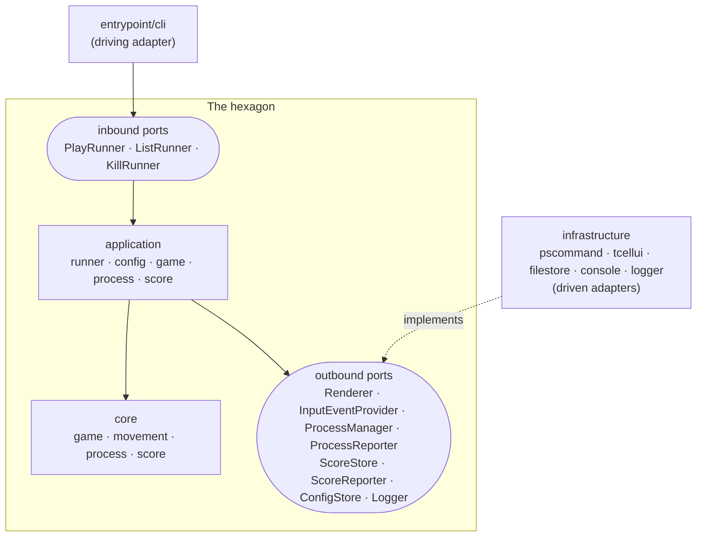
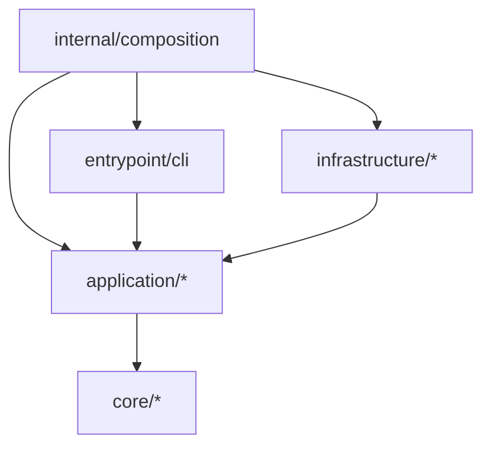

# Hexagonal Architecture — pidshooter

This document describes pidshooter's hexagonal architecture as it is today.

---

## Contents

1. [What hexagonal architecture means here](#1-what-hexagonal-architecture-means-here)
2. [The three layers](#2-the-three-layers)
3. [Conceptual diagram](#3-conceptual-diagram)
4. [Port interfaces (contracts)](#4-port-interfaces-contracts)
5. [Package dependencies](#5-package-dependencies)
6. [Composition root](#6-composition-root)

---

## 1. What hexagonal architecture means here

Hexagonal architecture (Ports & Adapters, Alistair Cockburn, 2005) separates software into three concentric zones:

| Zone | Responsibility | Rule |
|---|---|---|
| **Domain** | Business logic — what the application *is* | No imports from outer layers; no infrastructure |
| **Ports** | Contracts — what the domain *needs* or *exposes* | Interfaces plus the plain data and error types they exchange, owned by the application layer |
| **Adapters** | Connections to the outside world — how the world *connects* to the domain, and how the domain reaches it | Driving adapters call inbound ports; driven adapters implement outbound ports; both import libraries and OS APIs |

The "hexagon" is just the domain + its port interfaces. Everything outside is an adapter. There is no hexagonal shape; the name refers to the six notional faces Cockburn drew to show multiple interchangeable adapters around a single core.

Two kinds of adapters:

- **Driving (primary)** — they initiate action: the CLI parses `os.Args` and calls into the application.
- **Driven (secondary)** — they are called by the application service: OS process discovery, tcell rendering, JSON score storage.

---

## 2. The three layers

The code is organized in three layers. Dependencies only point inward: the adapters depend on the application, the application depends on the core, and the core depends on nothing but itself.

### Core — the domain

Pure Go. It imports only the standard library and other core packages.

| Package | What it is for |
|---|---|
| `core/game` | The game itself: its targets, their lifecycle and the rules of a session |
| `core/movement` | How the targets move and how fast |
| `core/process` | What a process is and which ones may be targeted |
| `core/score` | Scores and how they are ranked |

### Application — the use cases and the ports

It defines the ports and implements what the program does. Each service has its own request and result types, so the services stay independent of each other.

| Package | What it is for |
|---|---|
| `application/runner` | Runs a command from start to finish |
| `application/config` | Works out the configuration of a run |
| `application/process` | Finds and terminates processes |
| `application/game` | Runs a game session |
| `application/score` | Keeps and reports the scores |
| `application/input` | The user's input events |
| `application/apperror` | Classifies errors and decides how each one is handled |
| `application/contract` | The ports: what the application exposes to and needs from the outside world, inbound and outbound |

### Adapters — the connection to the outside world

Adapters import libraries and OS APIs; the core never does. Driving adapters call the inbound ports, and driven adapters implement the outbound ports.

| Package | Kind | What it is for |
|---|---|---|
| `entrypoint/cli` | driving | The command-line interface |
| `infrastructure/pscommand` | driven | Finds and terminates operating system processes |
| `infrastructure/tcellui` | driven | The terminal display and the user's keyboard and mouse input |
| `infrastructure/filestore` | driven | Persistent storage of the scores and the configuration |
| `infrastructure/console` | driven | Reports results to the user |
| `infrastructure/logger` | driven | Logs warnings and errors |

The composition root, `internal/composition`, builds the program and wires these pieces together (see [Composition root](#6-composition-root)).

---

## 3. Conceptual diagram

---

## 4. Port interfaces (contracts)

The ports are the contracts between the application and the outside world. The application defines them in `application/contract`, together with the data they exchange, and splits them by direction: inbound ports are how the outside world asks the application to do something, and outbound ports are what the application needs from the outside world.

### Inbound

| Port | What it is for |
|---|---|
| `PlayRunner` | Play a game |
| `ListRunner` | List the matching processes |
| `KillRunner` | Kill the matching processes |

Each takes its own request: the search patterns and the options the caller provided.

### Outbound

| Port | What it is for |
|---|---|
| `ProcessManager`, `ProcessHandle` | Discover running processes and terminate them |
| `ProcessReporter` | Report which processes matched |
| `ScoreStore` | Persist and retrieve the scores |
| `ScoreReporter` | Report the outcome of a game |
| `ConfigStore` | Persist and retrieve the configuration |
| `Renderer` | Draw the game to the display |
| `InputEventProvider` | Supply the user's input events |
| `Logger` | Log warnings and errors |

### Rules of the contracts

- A process handle stays bound to the process it was obtained for, even if that process ID is later reused.
- Acting on a process that no longer exists reports a not-found error.
- A store reports a missing file as not found, and unreadable data as corrupted.
- The renderer must be initialized before its window size is read or anything is drawn.
- The input event stream is closed when no more events will be produced.

---

## 5. Package dependencies

Arrows between groups mean "imports": everything points inward toward `core`.

The rules the dependencies follow:

- Dependencies only point inward. The core depends on nothing, and the application depends on the core.
- The application defines the ports. Adapters depend on those contracts, never on each other.
- The services do not depend on one another.
- Only the composition root knows every piece: it connects the adapters and the application. `main` knows only the composition root and the command-line interface.

The contracts live in the application, not in the core, so the core stays unaware of how it is driven and of what it is connected to.

---

## 6. Composition root

The composition root is the one place that knows every piece. It builds the adapters and the services, connects them through the ports, and hands the finished program to `main`, so `main` is one call chain. It lives in `internal/composition`.

- It is wiring, not logic: it makes no behavioral decisions.
- Nothing a command needs is built until that command runs, so showing the help or reporting a malformed command never sets up the terminal, the files or the external programs.
- One error handler is created here and shared by everything that reports errors.

How a run ends:

- A malformed or invalid command is reported with its usage text and ends with exit code 2.
- Any other failure, including a refused run as root, is reported without usage text and ends with exit code 1.
- With no arguments, the help is printed.
